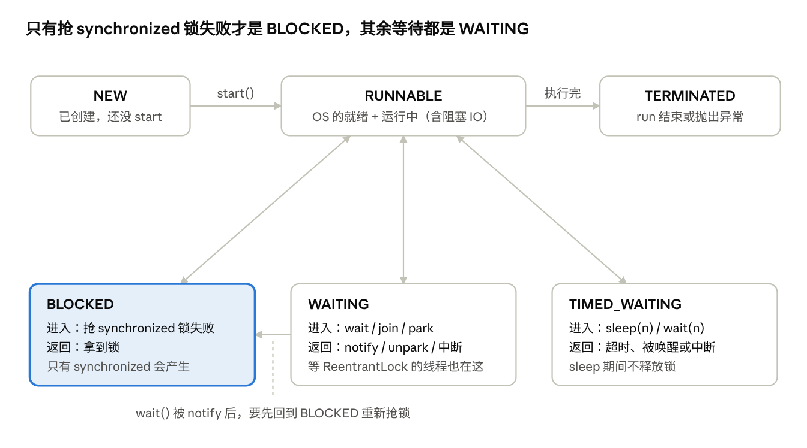
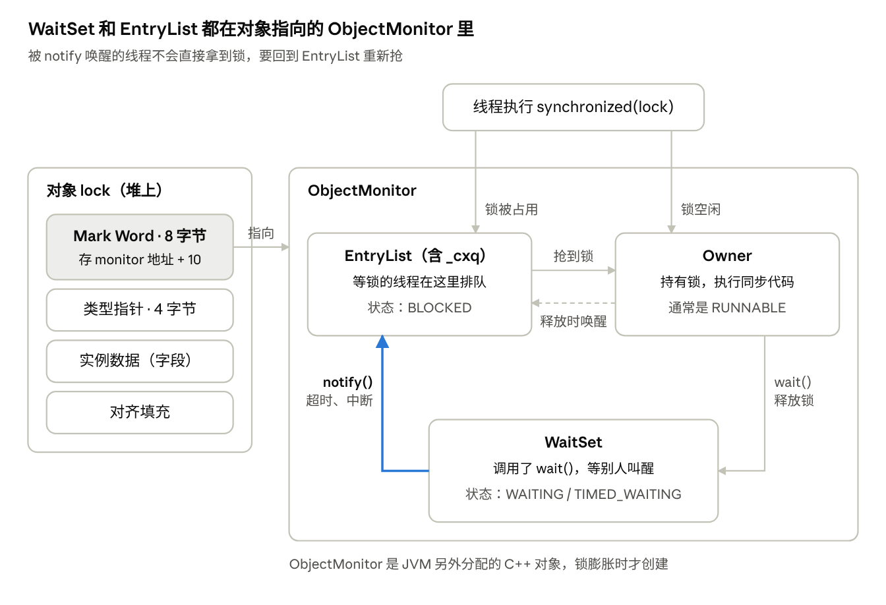
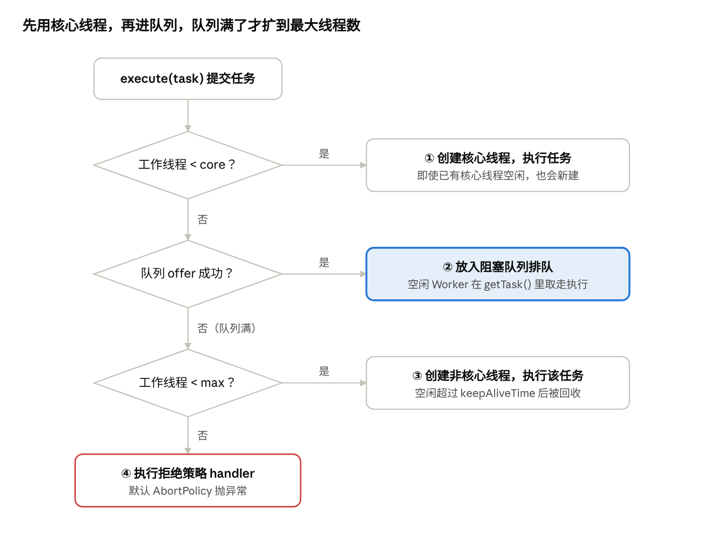

# Java 并发（JUC）系统学习手册

## 导读：一条主线串起整个 JUC

并发问题的根源只有三个：**可见性、有序性、原子性**。JUC 里几乎所有东西，都是在用不同的代价解决这三个问题。按这条主线学，比按题背更容易记住。

整条主线可以这样理解：

1. **硬件层**：CPU 有缓存、会重排序、线程会被切换 → 产生可见性、有序性、原子性问题。
2. **语言层（JMM）**：Java 用 happens-before 规则给程序员承诺，用 volatile、synchronized、final 兑现。
3. **锁的两种路线**：
   - 悲观路线：synchronized（JVM 实现，靠对象头 + monitor）。
   - 乐观路线：CAS（CPU 指令 cmpxchg），是原子类和 AQS 的地基。
4. **AQS**：CAS + volatile state + 等待队列 + park/unpark，搭出一个通用的“排队取锁”框架；ReentrantLock、Semaphore、CountDownLatch 都只是在它上面改了“state 怎么算”。
5. **工程层**：线程池管理线程，CompletableFuture 编排异步任务，ThreadLocal 隔离数据，并发容器替代手动加锁。

### 单元顺序

| 单元 | 一句话核心 | 依赖前置 |
| --- | --- | --- |
| 一 线程基础 | 线程是什么、怎么跑、怎么停 | 无 |
| 二 JMM 与 volatile | 三大问题从哪来，volatile 解决了哪两个 | 一 |
| 三 synchronized | 对象头 + monitor，锁升级为了少进内核 | 二 |
| 四 CAS 与原子类 | 无锁的乐观并发，AQS 的地基 | 二 |
| 五 AQS | state + CLH 队列 + park/unpark | 三、四 |
| 六 AQS 同步器 | ReentrantLock、Semaphore 等只是改了 state 的含义 | 五 |
| 七 线程池 | 7 个参数 + 一张执行流程图 | 一、六 |
| 八 CompletableFuture | Future 的缺点与异步编排 | 七 |
| 九 ThreadLocal | Thread 里挂一张 Map，弱引用与泄漏 | 一 |
| 十 并发容器与死锁 | CHM、COW、阻塞队列，死锁四条件 | 四、六 |
| 十一 手写题 | 用 synchronized / Lock / Semaphore 做线程协作 | 三、六 |

### 怎么用这份文档

每个单元都按同一个顺序组织，建议照这个节奏学：

1. **看学习目标**：单元开头标出了「必会 / 加分 / 了解」三档。时间紧就只啃「必会」，面试想拉开差距再看「加分」。
2. **先看现象，再学原理**：能用代码复现的问题（死循环停不下来、票卖超了），先给出可运行的代码和真实运行结果，再解释为什么。
3. **读原理**：每节按「为什么需要 → 底层怎么实现」展开，图和源码只保留理解所需的部分。标题里带「底层预备」的小节（2.3 CPU 缓存）是后文反复引用的地基，第一次读不要跳过。
4. **背「面试这样说」**：单元末尾给出 30 秒左右的口述回答，引用块里的话可以直接说出口。它是原理的压缩版，先读懂原理再背，才不会被追问问倒。
5. **做自测**：合上文档自己口述一遍，答不上来再回看正文。
6. **动手**：手写题（单元十一）建议在 IDE 里亲手敲一遍并跑通。手撕时最容易在 `while` 还是 `if`、`notify` 还是 `notifyAll` 上出错。

版本说明：以 JDK 8 为基准，涉及 JDK 15（偏向锁废弃）、JDK 17、JDK 21（虚拟线程）的变化会单独标出。文中所有可运行的示例代码都已在 JDK 17 上实际跑过。

内容依据：[小林coding · Java 并发面试题](https://xiaolincoding.com/interview/juc.html)，[JavaGuide 并发常见面试题（上）](https://javaguide.cn/java/concurrent/java-concurrent-questions-01.html)、[（中）](https://javaguide.cn/java/concurrent/java-concurrent-questions-02.html)、[（下）](https://javaguide.cn/java/concurrent/java-concurrent-questions-03.html)。

## 单元一 线程基础：线程是什么、怎么跑、怎么停

本单元的核心：Java 线程就是操作系统线程（1:1），创建、切换、阻塞都要操作系统出手，有实实在在的成本。这是后面“锁优化”和“线程池”存在的理由。

**学完这个单元，你能：**

- 说清进程和线程的区别，以及为什么局部变量天然线程安全。
- 说出线程的 6 种状态，分清“等锁”的 BLOCKED 和“等通知”的 WAITING。
- 用中断正确地停止一个线程，并处理好 InterruptedException。

### 1.1 进程与线程

- **进程**是资源分配的单位：启动一个 `main` 就是启动一个 JVM 进程。
- **线程**是 CPU 调度的单位：一个进程里可以有很多线程，它们共享这个进程的内存。

学并发只需要分清 Java 内存里的两块地方：

- **堆**：所有 new 出来的对象都在这里，所有线程共享。对象的字段（成员变量）可能被多个线程同时读写，并发问题就出在这里。
- **栈**：每个线程各有一份，存方法里的局部变量。别的线程看不到，所以局部变量天然线程安全。

### 1.2 Java 线程和操作系统线程

- 现在的 Java 线程是**平台线程，一个 Java 线程对应一个内核线程（1:1）**，调度交给 OS。所以创建一个线程要分配栈（默认 1MB）、要系统调用，成本不低。这就是工程里要用线程池复用线程的原因（单元七）。
- JDK 21 引入了**虚拟线程**：大量虚拟线程共用少量内核线程，等 IO 时把内核线程让出来，适合 IO 密集的场景。本手册讲的都是平台线程。

### 1.3 并发、并行与“为什么用多线程”

- **并发**：同一时间段内多个任务交替执行；**并行**：同一时刻多个任务在多个核上同时执行。
- 多线程的价值：多核并行计算；一个线程等 IO 时，另一个线程用 CPU。
- **单核支持多线程吗？** 支持，靠时间片轮转（抢占式调度）。
- **单核上多线程一定更快吗？** 不一定。CPU 密集型任务在单核上开多线程只会增加上下文切换开销；IO 密集型才受益。这个结论直接影响单元七的线程池大小。
- **上下文切换**：时间片用完、主动 sleep/wait、等锁、等 IO 时发生。要保存和恢复线程“执行到哪儿了”的现场，并在用户态和内核态之间来回。
- 多线程带来的问题：线程安全（结果错）、死锁、上下文切换开销、内存泄漏（如 ThreadLocal）。

类比记忆：一个人轮流做饭、打扫、洗衣服，是**并发**（同一段时间应对多件事）；三个人各干一件，是**并行**（同一时刻都在做）。两个人抢一口锅时就产生了竞争，这就是后面要学“锁”的原因。

**什么叫“进内核”**：线程的创建、挂起、唤醒都由操作系统内核负责。Java 线程要睡下或被叫醒，必须从普通程序运行的**用户态**切换到**内核态**，处理完再切回来。这一来一回通常要微秒级，而一次 CAS 或一次加法只要纳秒级，差了上千倍。后文说的“重量级”“挂起开销”指的都是这笔账：**锁优化的目标，就是尽量不让线程真的睡下去**。

### 1.4 创建线程：写法很多，本质只有一种

```java
// 1. 继承 Thread
class MyThread extends Thread { public void run() { System.out.println("hi"); } }
new MyThread().start();

// 2. 实现 Runnable（任务与线程解耦，推荐）
new Thread(() -> System.out.println("hi")).start();

// 3. Callable + FutureTask（有返回值、能抛受检异常）
FutureTask<Integer> task = new FutureTask<>(() -> 1 + 1);
new Thread(task).start();
Integer r = task.get(); // 阻塞等结果

// 4. 线程池（工程里的正确做法，见单元七）
executor.submit(() -> 1 + 1);
```

上面都只是“定义任务”的方式，**真正创建线程的只有 `new Thread().start()`**。FutureTask 本身就是一个 Runnable，线程池内部也是 new Thread。

**start() 和 run() 的区别**：`start()` 会让 JVM 向操作系统申请一个新线程，新线程准备好后再去执行 `run()`。直接调 `run()` 只是在当前线程里执行了一个普通方法。同一个线程对象 `start()` 两次，会抛 `IllegalThreadStateException`。

### 1.5 六种状态

`Thread.State` 枚举定义了 6 种状态（下方还会画一张状态转换图）：

- **NEW**：new 了还没 start。
- **RUNNABLE**：包含 OS 层面的“就绪”和“运行中”。Java 不区分两者，因为时间片只有几十毫秒，区分没意义。在做阻塞 IO 的线程，Java 里也是 RUNNABLE。
- **BLOCKED**：**只在等 `synchronized` 的锁时出现**。
- **WAITING**：主动等别人唤醒，无超时：`wait()`、`join()`、`LockSupport.park()`。
- **TIMED\_WAITING**：带超时的等待：`sleep(n)`、`wait(n)`、`join(n)`、`parkNanos`。
- **TERMINATED**：run 结束或抛出异常。



上排是主线；下排三种等待状态都从 RUNNABLE 进入，也都回到 RUNNABLE。

**BLOCKED 和 WAITING 的区别**：BLOCKED 是在**等锁**，抢 synchronized 的锁没抢到，锁一释放就自动去抢；WAITING 是在**等通知**，自己主动停下，必须等别的线程 notify、unpark 或中断它。单元三会看到，这两种线程分别待在 monitor 的两个不同区域。

一个反直觉的点：**等 `ReentrantLock` 的线程是 WAITING，不是 BLOCKED**。因为 AQS 是用 `LockSupport.park()` 挂起线程的（见单元五）。用 jstack 看到大量 `WAITING (parking)` 就是这个原因。

**wait 中的线程怎么回到 RUNNABLE**：被 notify/notifyAll、超时或被中断后，它**先进入 BLOCKED 重新抢锁**，抢到了才是 RUNNABLE，并从 `wait()` 的下一行继续执行。

### 1.6 中断与停止线程

Java 没有办法强制杀死一个线程，只能“请求”它停下——这就是中断。

- `t.interrupt()`：给 t 设置中断标志。如果 t 正阻塞在 `sleep/wait/join` 上，会被唤醒并抛 `InterruptedException`，**同时清除中断标志**。
- `t.isInterrupted()`：只查看标志。`Thread.interrupted()`：静态方法，查看并**清除**当前线程的标志。
- 对 `LockSupport.park()` 中的线程，interrupt 会让它直接返回，不抛异常，也不清标志。

**正确停止线程的写法**：

```java
Thread t = new Thread(() -> {
    while (!Thread.currentThread().isInterrupted()) {
        try {
            doWork();
            Thread.sleep(100);
        } catch (InterruptedException e) {
            // 异常抛出时标志已被清除，要重新设置，否则循环停不下来
            Thread.currentThread().interrupt();
        }
    }
});
t.start();
t.interrupt();
```

- 也可以用 `volatile boolean running` 标志位，但它叫不醒正在 sleep 的线程，所以 interrupt 更通用。
- `Thread.stop()` 已废弃：它会立刻释放线程持有的所有锁，可能让对象停在“改了一半”的状态。
- 线程池里的任务：`future.cancel(true)` 或 `shutdownNow()`，底层也是 interrupt。

### 1.7 守护线程、join 与 yield

- **守护线程**：`setDaemon(true)` 且必须在 start 前调用。所有非守护线程结束后 JVM 就退出，守护线程的 finally 不保证执行。GC 线程就是守护线程。
- **join()**：`t.join()` 让当前线程等 t 执行完再继续，11.4 节会用它控制线程的执行顺序。
- **yield()**：提示调度器让出 CPU，仍是 RUNNABLE，可能马上又被选中。

### 面试这样说

**问：线程有哪些状态，怎么转换？**

> Java 在 Thread.State 里定义了 6 种状态。new 出来还没 start 是 NEW；start 后进入 RUNNABLE，它包含操作系统层面的就绪和运行；run 执行完就是 TERMINATED。中间有三种等待：抢 synchronized 锁失败进入 BLOCKED，拿到锁就回到 RUNNABLE；调用 wait、join 或 LockSupport.park 进入 WAITING，要等别人 notify 或 unpark；带超时的 sleep、wait(n) 进入 TIMED\_WAITING，时间到自动返回。补充一点：wait 的线程被唤醒后，要先回到 BLOCKED 重新抢锁。

**问：如何停止一个正在运行的线程？**

> 推荐用中断。调用 t.interrupt() 设置中断标志，线程在循环里检查 isInterrupted() 决定是否退出。如果线程正阻塞在 sleep、wait 上，会抛 InterruptedException 并清除标志，所以 catch 里要再调一次 interrupt() 恢复标志。也可以用 volatile 标志位，但它叫不醒正在 sleep 的线程。stop() 已经废弃，因为它会强行释放所有锁，让数据停在改了一半的状态。

### 自测

- [ ] 为什么局部变量是线程安全的，成员变量不是？
- [ ] 等 ReentrantLock 的线程是什么状态？为什么？
- [ ] catch 到 InterruptedException 后为什么要再调一次 interrupt()？

## 单元二 JMM 与 volatile：并发 bug 从哪里来

本单元的核心：并发 bug 来自三个硬件/编译器优化，JMM 用 happens-before 给出可见性承诺，volatile 用内存屏障兑现其中的**可见性和有序性，但不管原子性**。

**学完这个单元，你能：**

- 用两段能跑的代码，说清可见性、有序性、原子性三类问题从哪来。
- 用 synchronized 修好一段线程不安全的代码。
- 说清 volatile 能保证什么、不能保证什么，并写出正确的 DCL 单例。

### 2.0 先看现象：两段会出错的代码

先把问题跑出来，后面的原理就是在解释这两个现象。

**现象一：改了变量，循环却停不下来（可见性）**

```java
public class ForeverLoop {
    static boolean stop = false;            // 加上 volatile 后循环就能停下

    public static void main(String[] args) throws InterruptedException {
        new Thread(() -> {
            try { Thread.sleep(100); } catch (InterruptedException ignored) {}
            stop = true;
            System.out.println("已把 stop 改为 true");
        }).start();

        int i = 0;
        while (!stop) {                     // JIT 优化后可能变成 while (true)
            i++;
        }
        System.out.println("循环结束，i = " + i);
    }
}
```

在 JDK 17 上实测：打印了“已把 stop 改为 true”，但 3 秒后程序仍在循环。把 `stop` 改成 `volatile` 后，循环立刻结束。原因在 JIT（即时编译器）：HotSpot 一开始逐条解释执行字节码，发现某段代码执行得特别频繁（热点代码），就把它编译成机器码并做激进优化。这里循环执行次数太多，JIT 认为 `stop` 在循环里没人改，就把它提到循环外只读一次，等价于 `while (true)`。volatile 告诉 JIT 和 CPU：这个变量每次都要读最新值。

**现象二：票卖重了（原子性）**

```java
public class TicketDemo {
    private int tickets = 10000;

    public void sell() {                    // 改成 synchronized void sell() 就正确了
        if (tickets > 0) {
            tickets--;
        }
    }

    public static void main(String[] args) throws InterruptedException {
        TicketDemo demo = new TicketDemo();
        Thread[] ts = new Thread[4];
        for (int i = 0; i < 4; i++) {
            ts[i] = new Thread(() -> { for (int j = 0; j < 5000; j++) demo.sell(); });
            ts[i].start();
        }
        for (Thread t : ts) t.join();
        System.out.println("剩余票数：" + demo.tickets + "（正确应为 0）");
    }
}
```

4 个线程一共调用 20000 次 `sell()`，票应该全部卖光。实测 3 次得到剩余 2183、1645、0。余票没减完，说明有两个线程读到了同一个票数、各自减 1 后写回，同一张票被卖了两次。还要注意，第 3 次的结果刚好对了：**并发 bug 不是每次都会出现，跑对一次不代表代码正确**。

### 2.1 先修好它：synchronized 怎么用

现象二只要给 `sell()` 加上 `synchronized` 就对了。synchronized 是 Java 内置的锁：同一时刻，只允许一个线程执行被它保护的代码。它有三种写法，区别在于锁的是哪个对象：

```java
public synchronized void a() {}          // 锁当前实例 this
public static synchronized void b() {}   // 锁当前类的 Class 对象
synchronized (lockObj) { }               // 锁括号里的对象
```

- **静态方法和普通方法的区别**：锁的是不同对象（Class 对象 vs this），所以一个线程调静态同步方法、另一个调实例同步方法，**不互斥**。
- 不要锁 String 常量和 `Integer` 等包装类：字符串常量池和 Integer 缓存会让不相关的代码锁到同一个对象；`count++` 之后 Integer 又变成了新对象，锁就失效了。
- 构造方法不能用 synchronized 修饰（语法不允许），因为对象构造完成前其他线程本来就拿不到它的引用。

### 2.2 三大问题的根源

| 问题 | 根源 | 典型现象 | 谁来解决 |
| --- | --- | --- | --- |
| 可见性 | 每个 CPU 核有自己的缓存，写入先进缓存/写缓冲 | 线程 A 把 flag 改成 true，线程 B 一直读到 false，死循环 | volatile、synchronized、Lock、final |
| 有序性 | 编译器和 CPU 为了性能重排指令 | DCL 单例拿到半初始化对象 | volatile、synchronized |
| 原子性 | 线程在任意两条指令之间都可能被切走 | `count++` 丢失更新 | synchronized、Lock、CAS/原子类 |

**有序性为什么会出问题**：编译器和 CPU 都会为了性能调整指令顺序，但遵守 as-if-serial 规则：不管怎么重排，**单线程**的执行结果不变，有数据依赖的指令也不会被重排。问题在于它只照顾单线程：你在一个线程里先后写两个没有依赖的变量，另一个线程看到的顺序可能是反的。

`count++` 为什么不是原子的？它对应三步：读 count 到寄存器 → 寄存器 +1 → 写回。两个线程都读到 5，都写回 6，就丢了一次。

用 `javap -c` 反编译可以亲眼看到这三步。下面是成员变量 `count++` 在 JDK 17 上编译出的字节码：

```text
0: aload_0
1: dup
2: getfield      #13                 // Field count:I
5: iconst_1
6: iadd
7: putfield      #13                 // Field count:I
```

`getfield` 读、`iadd` 加、`putfield` 写回，是三条独立的指令。线程可以在任意两条之间被切走，读和写回之间只要插进别的线程的写，就会丢一次更新。JIT 编译成机器码后，也仍然是读、加、写三步。

**场景题：两个线程各对 `int x = 0` 执行 50 次 `x++`，结果可能是多少？** 答：最大 100；大多数人会答最小 50，但理论最小是 **2**。构造方式：A 读到 0 后被挂起；B 跑完 49 次；A 写回 1；B 读到 1 后被挂起；A 跑完剩下 49 次；B 写回 2。

### 2.3 底层预备：从 CPU 缓存到 JMM

**先看硬件：一个核写的值，另一个核为什么看不到**

CPU 算得太快、内存太慢，所以每个核和内存之间隔着好几层缓存。越靠近核越快，容量也越小：

| 层级 | 归属 | 访问耗时（量级） |
| --- | --- | --- |
| 寄存器 | 每个核私有 | 不到 1 纳秒 |
| L1 / L2 缓存 | 每个核私有 | 1\~5 纳秒 |
| L3 缓存 | 多个核共享 | 十几纳秒 |
| 内存 | 所有核共享 | 约 100 纳秒 |

- **缓存行**：缓存不是一个变量一个变量地存，而是按“行”整块搬运，常见的 x86 是 64 字节（Apple M 系列是 128 字节）。一个核改了某个变量，实际是改了它所在的那一整行。4.5 节的伪共享就是这么来的。
- **MESI 协议**：保证多个核缓存同一行时数据一致。每个缓存行有 4 种状态：M（已修改，只有我有，和内存不一致）、E（独占，只有我有，和内存一致）、S（共享，多个核都有）、I（失效，不能再用）。核心规则只有一条：**一个核要写某一行，必须先让其他核里的这一行变成 I**。
- **写缓冲与失效队列**：严格按 MESI 走，每次写都要等其他核回复“已失效”，太慢了。所以 CPU 加了两个队列：写操作先放进**写缓冲（Store Buffer）**就接着往下执行；收到的失效通知先放进**失效队列（Invalidate Queue）**，稍后再处理。

代价是：A 核写了，B 核一段时间内还读到旧值，这是**可见性**问题；A 核先后写的两个变量，B 核看到的顺序可能和写入顺序不一致（在 ARM 等弱内存模型的 CPU 上更明显），这是**有序性**问题。**内存屏障**的作用就是强制清空这两个队列，2.5 节的 volatile 靠的就是它。所以“有了 MESI 为什么还要 volatile”的答案是：MESI 本身是一致的，不一致来自它前面的这两个队列。

**JMM 把这些硬件细节抽象成一个简单模型**：

- JMM（Java Memory Model）是一套**规范**，不是 JVM 的内存区域（堆、栈那个叫“运行时数据区”，别混）。
- 它的抽象：共享变量在**主内存**，每个线程有自己的**工作内存**（对应 CPU 缓存、寄存器、写缓冲）。线程只能操作工作内存，再同步回主内存。
- 它的作用：屏蔽 x86、ARM 等硬件内存模型的差异，给程序员一个统一的承诺：**只要你按规则写（用 volatile/锁），就能看到正确的结果**。

### 2.4 happens-before：JMM 给的承诺

**定义**：如果 A happens-before B，那么 A 的结果对 B 可见，且 A 的执行顺序看起来在 B 之前。它说的是**可见性**，不是时间上的先后；JVM 可以重排，只要结果不违反这个关系。

最常用的 6 条规则：

1. **程序顺序规则**：同一线程内，前面的操作 hb 后面的操作。
2. **监视器锁规则**：解锁 hb 之后对同一把锁的加锁。
3. **volatile 规则**：对 volatile 变量的写 hb 之后对它的读。
4. **传递性**：A hb B，B hb C，则 A hb C。
5. **start 规则**：`t.start()` hb t 里的任何操作。
6. **join 规则**：t 里的任何操作 hb `t.join()` 返回。

规则 1 + 3 + 4 组合起来就是 volatile 的“顺风车”效应：

```java
int data = 0;
volatile boolean ready = false;

// 线程 A
data = 42;        // ①
ready = true;     // ② volatile 写

// 线程 B
if (ready) {      // ③ volatile 读
    print(data);  // ④ 一定是 42
}
// ① hb ②（程序顺序），② hb ③（volatile），③ hb ④（程序顺序）⇒ ① hb ④
```

### 2.5 volatile 的底层：内存屏障

**可见性**：写 volatile 变量时，立即刷回主存，并让其他 CPU 中该缓存行失效；读时从主存重新加载。在 x86 上，JIT 编译后的 volatile 写会多一条 `lock addl $0x0,(%rsp)` 指令，`lock` 前缀的作用就是清空写缓冲并广播失效。

**有序性**：编译器在 volatile 读写前后插入内存屏障。屏障按“禁止哪两类操作交换顺序”分 4 种：LoadLoad、StoreStore、LoadStore、StoreLoad。

| 位置 | 插入的屏障 | 作用 |
| --- | --- | --- |
| volatile 写之前 | StoreStore | 前面的普通写不能排到 volatile 写后面 |
| volatile 写之后 | StoreLoad | volatile 写不能和后面的读交换（开销最大的一种） |
| volatile 读之后 | LoadLoad | 后面的读不能排到 volatile 读前面 |
| volatile 读之后 | LoadStore | 后面的写不能排到 volatile 读前面 |

记忆法：**volatile 写是“收尾”**，之前的写必须先完成；**volatile 读是“开头”**，之后的操作必须等它读完。x86 本身只会发生 Store-Load 重排，所以实际只需要那一条 lock 指令。

使用技巧（由上面的屏障规则直接推出）：一组写操作里，**把 volatile 变量的写放在最后**；一组读操作里，**把 volatile 变量的读放在最前**。2.4 节的 data/ready 例子就是这样写的。如果把 volatile 加在 data 上、ready 不加，屏障挡不住 ready 的写被提前，就保证不了顺序。

### 2.6 volatile 不保证原子性

```java
volatile int count = 0;
// 10 个线程各执行 1000 次 count++，结果通常小于 10000
```

volatile 只保证“读到的是最新值”，但读、加、写三步之间仍然会被别的线程插队。解决方式：`synchronized`、`ReentrantLock`、`AtomicInteger`。

**volatile 的适用场景**：一写多读的状态标志位（如 `running`）、DCL 单例、配合 CAS 使用（原子类和 AQS 里的 value/state 都是 volatile）。

### 2.7 DCL 单例：为什么已经有 synchronized 还要 volatile

```java
public class Singleton {
    private static volatile Singleton instance;   // volatile 不能少
    private Singleton() {}

    public static Singleton getInstance() {
        if (instance == null) {                  // 第一次检查：避免每次都加锁
            synchronized (Singleton.class) {
                if (instance == null) {          // 第二次检查：防止重复创建
                    instance = new Singleton();
                }
            }
        }
        return instance;
    }
}
```

`instance = new Singleton()` 实际是三步：① 分配内存 → ② 调用构造方法初始化 → ③ 把引用赋给 instance。②③ 可能重排为 ①③②。线程 A 执行完 ③ 还没 ② 时，线程 B 在**锁外面**的第一次检查看到 instance 不为 null，直接拿去用，就用到了未初始化的对象。

synchronized 只保证锁内的线程看到正确结果，第一次检查在锁外，不受它保护。volatile 的 StoreStore 屏障保证②一定在③之前。

### 2.8 volatile 与 synchronized 对比

| 对比项 | volatile | synchronized |
| --- | --- | --- |
| 修饰对象 | 只能修饰变量 | 方法、代码块 |
| 可见性 | 保证 | 保证（解锁前刷主存，加锁时清工作内存） |
| 有序性 | 保证（禁止重排） | 保证“结果有序”（临界区内仍可重排，但单线程执行，外界无感） |
| 原子性 | **不保证** | 保证 |
| 是否阻塞 | 不阻塞 | 可能阻塞 |
| 性能 | 轻量，读几乎和普通变量一样 | 经锁优化后也不差，但重度竞争时要进内核 |

### 面试这样说

**问：导致并发程序出问题的根本原因是什么？**

> 三个：原子性、可见性、有序性。原子性是线程可能在任意两条指令之间被切换，比如 count++ 分读、加、写三步；可见性是 CPU 缓存和 JIT 优化导致一个线程的修改别人看不到；有序性是编译器和 CPU 会重排指令。synchronized 和 Lock 三个都能保证，volatile 只保证可见性和有序性，原子类用 CAS 保证单个变量的原子性。

**问：谈谈你对 JMM 的理解。**

> JMM 是 Java 内存模型，是一套规范，用来屏蔽不同硬件的内存差异。它把内存抽象成所有线程共享的主内存和每个线程私有的工作内存，线程只能操作自己的工作内存，再同步回主内存，这就带来了可见性问题。JMM 用 happens-before 规则告诉程序员，一个线程的写什么时候对另一个线程可见，比如解锁先于后续加锁、volatile 写先于后续读。volatile、synchronized、final 就是具体的实现手段。

**问：谈谈你对 volatile 的理解。**

> volatile 修饰共享变量，有两个作用。第一是可见性：一个线程写了它，其他线程马上能读到最新值。比如用 boolean 做停止标志，不加 volatile 的话，JIT 可能把循环优化成死循环。第二是禁止指令重排：读写它时会插入内存屏障，典型应用是 DCL 单例，防止别的线程拿到还没初始化完的对象。但它不保证原子性，count++ 这种读改写操作还是要用锁或 AtomicInteger。

### 自测

- [ ] 有了 MESI，为什么还需要 volatile？
- [ ] 用 happens-before 解释上面的 data/ready 例子。
- [ ] DCL 去掉 volatile 会出什么问题？去掉第二次检查呢？
- [ ] 两个线程各加 50 次，最小结果为什么是 2？

## 单元三 synchronized：对象头 + monitor + 锁升级

本单元的核心：synchronized 锁的是**对象**，锁的状态记在对象头的 Mark Word 里。锁升级的全部意义只有一个：**能不进内核就不进内核**。

**学完这个单元，你能：**

- 说清没抢到锁的线程在哪里排队，调用 wait 的线程又在哪里等。
- 正确使用 wait/notify：写在 synchronized 里，用 while 检查条件，多数情况用 notifyAll。
- 说出锁升级的四个状态，以及每一级省掉了什么开销。

单元二用 synchronized 修好了卖票程序（2.1 节）。本单元回答：这一个关键字在 JVM 里到底做了什么。

顺序是：先看它编译成了什么（3.1），再看抢不到锁的线程在哪里排队（3.2），然后是在锁里等待和唤醒（3.3），接着看锁的状态怎么记在对象头里（3.4），最后把这些串成锁升级的全过程（3.5）。

### 3.1 字节码层面

- **同步代码块**：编译出 `monitorenter` 和 `monitorexit` 指令。通常有**两个** monitorexit：一个在正常返回路径，一个在异常路径。这就是 synchronized 抛异常也会自动释放锁的原因。
- **同步方法**：没有这两条指令，而是在方法的 access flags 里加一个 `ACC_SYNCHRONIZED`。JVM 调用方法时看到它，就先去拿锁。
- 两者最终都是去获取对象关联的 monitor。

用 `javap -c -v` 反编译下面这段代码，可以亲眼看到这两种形式：

```java
public class SyncBytecode {
    private final Object lock = new Object();
    private int count;

    public void block() {
        synchronized (lock) { count++; }
    }

    public synchronized void method() { count++; }
}
```

JDK 17 实测输出（节选，右侧中文注释是后加的）：

```text
public void block();
     0: aload_0
     1: getfield      #7     // Field lock:Ljava/lang/Object;
     4: dup
     5: astore_1             // 把锁对象存进局部变量，留着解锁用
     6: monitorenter         // 加锁
     7: aload_0
     ...                     // count++
    17: aload_1
    18: monitorexit          // 正常出口：解锁
    19: goto          27
    22: astore_2             // 异常出口：先把异常存起来
    23: aload_1
    24: monitorexit          //           解锁
    25: aload_2
    26: athrow               //           再把异常抛出去
    27: return
  Exception table:
     from    to  target type
         7    19    22   any
        22    25    22   any

public synchronized void method();
  flags: (0x0021) ACC_PUBLIC, ACC_SYNCHRONIZED
```

异常表第一行的意思是：第 7\~19 条指令（同步块内部）抛出任何异常，都跳到第 22 条，先 monitorexit 再 athrow。这就是“synchronized 抛异常也会释放锁”的底层保证。第二行覆盖的是异常处理代码自己，是 javac 加的保险。再留意第 5 条：锁对象在加锁前就存进了局部变量，解锁时用的是这份副本，所以加锁和解锁一定是同一个对象。

### 3.2 Monitor：抢不到锁的线程在哪里等

Monitor（管程，也叫监视器）是操作系统课里的经典同步机制：一把互斥锁，加上排队和等待用的队列，保证同一时刻只有一个线程在里面执行。Java 把它和对象绑在了一起：`synchronized(obj)` 就是进入 obj 的 monitor，`obj.wait()` 和 `obj.notify()` 就是在这个 monitor 的等待区里等和叫人。

HotSpot 用一个 C++ 对象 `ObjectMonitor` 实现 monitor。有三点最容易误解：

- **它不在 Java 对象里**，是 JVM 另外分配的一块内存。对象通过对象头里的 Mark Word 找到它（Mark Word 是对象头里记录锁状态的 8 个字节，3.4 节细讲）。
- **不是每个对象一出生就有 monitor**。出现锁竞争，或者在锁内调用 `wait()` 时，JVM 才给对象分配一个，这叫“锁膨胀”。没有竞争的 synchronized 根本用不到它（3.5 节的锁升级）。
- **它内部分三个区域**，线程待在哪个区域，决定了它在 Java 里是什么状态。

用一间诊室来类比这三个区域：

| 区域 | 源码字段 | 诊室类比 | 线程状态 |
| --- | --- | --- | --- |
| Owner | `_owner` | 正在诊室里看病的人，同一时刻最多一个 | 持有锁，通常是 RUNNABLE |
| EntryList | `_EntryList`、`_cxq` | 门口排队、等着进诊室的人 | BLOCKED |
| WaitSet | `_WaitSet` | 看到一半发现化验结果没出来，主动出门去休息室等叫号的人 | WAITING 或 TIMED\_WAITING |

线程在三个区域间怎么流转，见下图。最关键的是最后一步：**叫号（notify）只是把人从休息室叫回门口排队，不是直接请进诊室**。



左边是对象本身，重量级锁时 Mark Word 存的是 ObjectMonitor 的地址。右边的三个区域里，虚线是 Owner 释放锁时叫醒一个等锁的线程，加粗的线是 notify 把线程送回 EntryList。

**跑一下看看**：下面的程序让三个线程分别待在三个区域里，再打印它们的状态。

```java
public class MonitorStateDemo {
    static final Object lock = new Object();

    public static void main(String[] args) throws Exception {
        Thread waiter = new Thread(() -> {
            synchronized (lock) {
                try { lock.wait(); } catch (InterruptedException ignored) { }  // 进 WaitSet，并释放锁
                System.out.println("waiter 被唤醒并重新拿到了锁");
            }
        }, "waiter");

        Thread owner = new Thread(() -> {
            synchronized (lock) {
                sleep(3000);        // 拿着锁睡觉：sleep 不释放锁
                lock.notify();      // 把 waiter 从 WaitSet 挪到 EntryList
                sleep(3000);        // 仍然拿着锁
            }
        }, "owner");

        Thread blocked = new Thread(() -> {
            synchronized (lock) { }  // 抢不到锁，进 EntryList
        }, "blocked");

        waiter.start();  Thread.sleep(100);
        owner.start();   Thread.sleep(100);
        blocked.start(); Thread.sleep(300);
        System.out.println("阶段一  owner=" + owner.getState()
                + "  blocked=" + blocked.getState() + "  waiter=" + waiter.getState());

        Thread.sleep(3000);  // 此时 owner 已经 notify，但还没释放锁
        System.out.println("阶段二  owner=" + owner.getState()
                + "  blocked=" + blocked.getState() + "  waiter=" + waiter.getState());

        owner.join(); blocked.join(); waiter.join();
    }

    static void sleep(long ms) {
        try { Thread.sleep(ms); } catch (InterruptedException ignored) { }
    }
}
```

JDK 17 实测输出：

```text
阶段一  owner=TIMED_WAITING  blocked=BLOCKED  waiter=WAITING
阶段二  owner=TIMED_WAITING  blocked=BLOCKED  waiter=BLOCKED
waiter 被唤醒并重新拿到了锁
```

- 阶段一：owner 拿着锁在 sleep，状态是 TIMED\_WAITING，但它仍然是 Owner，因为 **sleep 不释放锁**。blocked 在 EntryList，waiter 在 WaitSet。
- 阶段二：owner 已经 notify，但还没退出同步块。waiter 从 WaitSet 被挪到了 EntryList，状态从 WAITING 变成了 **BLOCKED**，还要等 owner 释放锁后再去抢。

程序运行时用 `jstack <进程号>` 看线程栈，能直接看到每个线程卡在 monitor 的哪个区域（阶段一，节选）：

```text
"waiter" ... in Object.wait()
   java.lang.Thread.State: WAITING (on object monitor)
    - waiting on <0x0000000697c1c210> (a java.lang.Object)

"owner" ... waiting on condition
   java.lang.Thread.State: TIMED_WAITING (sleeping)
    - locked <0x0000000697c1c210> (a java.lang.Object)

"blocked" ... waiting for monitor entry
   java.lang.Thread.State: BLOCKED (on object monitor)
    - waiting to lock <0x0000000697c1c210> (a java.lang.Object)
```

| jstack 里的字样 | 含义 | 所在区域 |
| --- | --- | --- |
| `- locked <地址>` | 持有这把锁 | Owner |
| `- waiting to lock <地址>` | 抢锁失败，正在排队 | EntryList |
| `- waiting on <地址>` | 调用了 wait，在等通知 | WaitSet |
| `- waiting to re-lock in wait() <地址>` | 已被 notify，正在重新抢锁（阶段二的 waiter） | EntryList |

三个线程后面的地址都是 `0x0000000697c1c210`，说明它们围着同一个对象的 monitor。线上排查锁问题时，按这个地址把线程归类，就能看出谁拿着锁、谁在排队。注意：jstack 在 waiter 自己的栈帧下也会显示一行 `- locked`，那只表示它是在这个同步块里调用的 wait，锁其实已经释放了。

线程在 monitor 里的流转：

1. 抢锁：CAS 把 `_owner` 设为自己。如果 `_owner` 已经是自己，`_recursions++`（**这就是 synchronized 可重入的实现**）。
2. 抢不到：先自适应自旋几轮，还抢不到就进入 `_cxq`，然后 park 挂起（BLOCKED）。
3. 持锁线程调 `wait()`：释放锁，进入 `_WaitSet`。
4. 其他线程调 `notify()`：把 WaitSet 里的一个线程移到 EntryList/cxq，它要**重新抢锁**。
5. 释放锁：`_recursions` 减到 0 后清空 `_owner`，并唤醒一个等待线程。唤醒的线程要和刚好到来的新线程竞争，所以 **synchronized 是非公平锁**。

**为什么等锁的队列有两个（\_cxq 和 \_EntryList）？** 新来的线程要并发地入队，用 CAS 压进 `_cxq` 最便宜（它是单向链表，后进先出）。释放锁时只有 Owner 一个线程在操作，它把 `_cxq` 里的线程挪到 `_EntryList`，再从 `_EntryList` 挑一个唤醒。这样“很多线程同时入队”只需要 CAS，“出队”完全不用额外同步。学习时把两者统称为“等锁队列”就够了。

**monitor 什么时候创建、什么时候回收？** 锁膨胀时创建：轻量级锁遇到竞争，或者在锁里调用了 wait（3.4 节 MarkWordDemo 的第 5、7 行会验证这一点）。不再使用的 monitor 会被 JVM 回收，对象回到无锁状态。所以常说的“锁不降级”，准确意思是：正在被使用的重量级锁，不会退回轻量级锁。

重量级锁为什么“重”：park/unpark 最终依赖 OS 的 mutex/futex，线程挂起和唤醒要在用户态和内核态之间切换，一次可能要微秒级，而临界区代码可能只要几纳秒。

把“进内核”展开，一次挂起的调用链大致是：`ObjectMonitor::enter` 自旋失败 → 调用当前线程的 park → 底层是 pthread 的互斥锁和条件变量 → 在 Linux 上最终是 `futex` 系统调用 → 内核把线程从运行队列里摘下，不再给它分配 CPU。唤醒时反过来再走一遍。这一来一回就是 1.3 节说的用户态、内核态切换。单元五的 `LockSupport.park()` 底层也是 pthread 条件变量，代价在同一个量级。

**可重入**：同一线程拿到锁后，可以再次获取同一把锁而不会自己把自己堵住。意义：同步方法 A 调用同步方法 B、子类同步方法调 `super` 的同步方法，都不会死锁。实现：记录“持有者 + 计数”，加一次 +1，释放一次 -1，减到 0 才真正释放。

### 3.3 wait 与 notify：在 Monitor 里等通知

持有锁的线程发现条件还不满足（比如队列是空的），可以调用 `wait()` 让出锁、进 WaitSet 等着；别的线程把条件改好后，用 `notify()` 叫醒它。

**sleep 与 wait 的区别**

| 对比项 | `Thread.sleep()` | `Object.wait()` |
| --- | --- | --- |
| 所属类 | Thread 的静态方法 | Object 的实例方法 |
| 是否释放锁 | **不释放** | **释放** monitor 锁 |
| 使用前提 | 任意位置 | 必须在 `synchronized` 内，否则抛 `IllegalMonitorStateException` |
| 唤醒方式 | 时间到自动醒 | notify/notifyAll、超时、中断 |
| 用途 | 暂停执行 | 线程间协作（等条件） |

- **sleep 会释放 CPU 吗？** 会，线程进入 TIMED\_WAITING，不参与调度；但它握着的锁不放。
- **为什么 wait 定义在 Object 而不是 Thread？** 因为锁属于对象。每个对象都可以关联一个 monitor（3.2 节），wait 要释放的是“这个对象的锁”，并进入“这个对象的等待集合（WaitSet）”。sleep 和锁无关，只影响当前线程，所以在 Thread 上。
- **为什么 wait 必须在 synchronized 里？** 机制上，只有 monitor 的 Owner 才能操作 WaitSet（3.2 节），没拿锁就调用会抛异常。设计上，这样规定是为了避免“丢失唤醒”：线程 A 判断条件不满足、还没来得及 wait，线程 B 就改了条件并 notify，A 再 wait 就永远等不到了。“判断条件 + wait”必须是原子的。

**notify 与 notifyAll**

- `notify()` 从该对象的 WaitSet 中唤醒一个线程，`notifyAll()` 唤醒全部，被唤醒的线程再竞争锁。
- **notify 选哪个？** JVM 规范说是“任意一个”。HotSpot 实现中通常按进入 WaitSet 的顺序唤醒，但代码不能依赖这一点。
- 多个线程等不同条件时（如 ABC 轮流打印），用 notify 可能叫醒“错的人”导致全员等待，所以要用 notifyAll，或者换成多个 Condition 精准唤醒。
- 被唤醒后条件不一定成立（其他线程可能先抢到锁改了数据，或者发生虚假唤醒），所以**wait 必须放在 while 循环里**：

```java
synchronized (lock) {
    while (!condition) {   // 不能用 if
        lock.wait();
    }
    // do something
}
```

“必须用 while”背后是 monitor 的一个设计选择。Java 采用的是 **Mesa 风格**：调用 notify 的线程继续执行，被唤醒的线程回到 EntryList，稍后再和别人一起抢锁（3.2 节的图）。它抢到锁之前，别的线程完全可能先进去把条件改掉。另一种 **Hoare 风格**会在 notify 时立刻把锁交给被唤醒者，条件一定成立，可以用 if；但它要多做一次线程切换，实现也更复杂，Java、pthread 等主流实现都没有采用。

### 3.4 对象头：锁的状态记在 Mark Word 里

3.2 节说过，monitor 是需要时才分配的；平时锁的状态直接记在对象自己身上。这一节看一个对象在内存里长什么样，锁的状态记在哪几个比特里。

**① 一个 Java 对象在堆里分三块**

| 组成部分 | 大小（64 位 JVM，默认开启压缩指针） | 存什么、有什么用 |
| --- | --- | --- |
| 对象头 · Mark Word | 8 字节 | 对象的运行时状态：hashCode、GC 分代年龄、**锁状态**。synchronized 的锁就记在这里 |
| 对象头 · 类型指针 | 4 字节 | 指向方法区（元空间）里这个类的元数据。`getClass()`、`instanceof`、调用重写的方法，都靠它找到对象属于哪个类 |
| 对象头 · 数组长度 | 4 字节，只有数组才有 | `arr.length` 读的就是这里 |
| 实例数据 | 各字段大小之和 | 字段的值，包括从父类继承的字段 |
| 对齐填充 | 0\~7 字节 | HotSpot 要求对象大小是 8 的倍数，不够就补齐 |

按这张表算：`new Object()` 的对象头是 8 + 4 = 12 字节，没有字段，补 4 字节凑成 **16 字节**；`new int[3]` 是 12 + 4（长度）+ 3 × 4 = 28 字节，补齐到 **32 字节**。在 JDK 17 上用 `Instrumentation.getObjectSize()` 实测，结果正是 16 和 32。

**② Mark Word：对象的“状态栏”**

Mark Word 只有 64 位，却要存好几样东西，所以它是**复用**的：JVM 先看最低 2 位的锁标志位，再决定怎么解读其余 62 位。两个顺手能记住的细节：

- GC 分代年龄只有 4 位，最大是 15。这就是 `-XX:MaxTenuringThreshold` 最多只能设成 15 的原因。
- hashCode 不是对象一创建就有的。第一次调用 `hashCode()` 时才算出来，写进这 31 位。

加锁以后，这 64 位会被改写成别的内容（比如一个指针），锁标志位也跟着变：01 无锁，00 轻量级锁，10 重量级锁。所以**在对象这一侧，“锁”就是 Mark Word 里的几个比特**，任何对象都能当锁用。每种状态具体存什么，见下表，后面还会用代码把真实的比特打印出来。

下表是 64 位 HotSpot 里，每种锁状态下这 64 位分别存什么：

| 锁状态 | 其余位存什么（从高位到低位） | 偏向位 | 锁标志位 |
| --- | --- | --- | --- |
| 无锁 | 未使用 25 位 + hashCode 31 位 + 未使用 1 位 + GC 年龄 4 位 | 0 | 01 |
| 偏向锁 | 持有锁的线程指针 54 位（常说的“线程 ID”）+ epoch 2 位 + 未使用 1 位 + GC 年龄 4 位 | 1 | 01 |
| 轻量级锁 | 指向持锁线程栈上 Lock Record 的指针 | — | 00 |
| 重量级锁 | 指向 ObjectMonitor 的指针 | — | 10 |
| GC 标记 | 给 GC 使用 | — | 11 |

**亲手打印出来**：`sun.misc.Unsafe` 可以按偏移量读对象里的任意字节，对象开头的 8 个字节就是 Mark Word。下面的程序在不同时刻读它，并按最低 3 位判断锁状态：

```java
import sun.misc.Unsafe;
import java.lang.reflect.Field;

public class MarkWordDemo {
    static class Point { int x; }

    private static final Unsafe U = getUnsafe();

    // 读对象开头的 8 个字节，就是 Mark Word（64 位 HotSpot）
    static String mark(Object o) {
        long m = U.getLong(o, 0L);
        String bits = String.format("%64s", Long.toBinaryString(m)).replace(' ', '0');
        String lock;
        switch ((int) (m & 0b11)) {
            case 0b01: lock = (m & 0b100) != 0 ? "偏向锁" : "无锁"; break;
            case 0b00: lock = "轻量级锁"; break;
            case 0b10: lock = "重量级锁"; break;
            default:   lock = "GC 标记";
        }
        return String.format("0x%016x  末三位 %s → %s", m, bits.substring(61), lock);
    }

    public static void main(String[] args) throws Exception {
        // ① 对象头有多大：看第一个字段从第几个字节开始
        System.out.println("Point.x 的偏移量 = " + U.objectFieldOffset(Point.class.getDeclaredField("x")));
        System.out.println("int[] 第一个元素的偏移量 = " + U.arrayBaseOffset(int[].class));

        // ② Mark Word 随锁状态变化
        Object o = new Object();
        System.out.println("1. 刚 new 出来      " + mark(o));

        int h = o.hashCode();
        long hashInMark = (U.getLong(o, 0L) >>> 8) & 0x7FFFFFFFL;
        System.out.println("2. 调用 hashCode 后  " + mark(o));
        System.out.printf("   hashCode() = 0x%x，Mark Word 第 8~38 位 = 0x%x%n", h, hashInMark);

        synchronized (o) {
            System.out.println("3. 单线程加锁中      " + mark(o));
        }
        System.out.println("4. 释放锁后          " + mark(o));

        Thread holder = new Thread(() -> {
            synchronized (o) { sleep(500); }
        });
        Thread contender = new Thread(() -> {
            synchronized (o) { }
        });
        holder.start();
        Thread.sleep(100);
        contender.start();
        Thread.sleep(100);
        System.out.println("5. 另一线程在抢锁    " + mark(o) + "（抢锁线程状态：" + contender.getState() + "）");
        holder.join();
        contender.join();

        Object p = new Object();
        synchronized (p) {
            System.out.println("6. 新对象加锁        " + mark(p));
            p.wait(10);
            System.out.println("7. 同一线程 wait 后  " + mark(p));
        }
    }

    static void sleep(long ms) {
        try { Thread.sleep(ms); } catch (InterruptedException ignored) { }
    }

    private static Unsafe getUnsafe() {
        try {
            Field f = Unsafe.class.getDeclaredField("theUnsafe");
            f.setAccessible(true);
            return (Unsafe) f.get(null);
        } catch (Exception e) {
            throw new RuntimeException(e);
        }
    }
}
```

JDK 17 实测输出：

```text
Point.x 的偏移量 = 12
int[] 第一个元素的偏移量 = 16
1. 刚 new 出来      0x0000000000000001  末三位 001 → 无锁
2. 调用 hashCode 后  0x0000005c647e0501  末三位 001 → 无锁
   hashCode() = 0x5c647e05，Mark Word 第 8~38 位 = 0x5c647e05
3. 单线程加锁中      0x000000016bddaad0  末三位 000 → 轻量级锁
4. 释放锁后          0x0000005c647e0501  末三位 001 → 无锁
5. 另一线程在抢锁    0x000000012693e942  末三位 010 → 重量级锁（抢锁线程状态：BLOCKED）
6. 新对象加锁        0x000000016bddaad0  末三位 000 → 轻量级锁
7. 同一线程 wait 后  0x0000000109404962  末三位 010 → 重量级锁
```

逐行看：

- **前两行**：第一个字段从第 12 字节开始，数组元素从第 16 字节开始，印证了上面“对象头 12 字节，数组多 4 字节长度”。
- **第 1、2 行**：刚创建时 hash 位全是 0；调用 hashCode() 后，中间那段 `5c647e05` 正好等于 hashCode() 的返回值。hashCode 确实存在 Mark Word 里，而且是第一次调用时才写进去的。
- **第 3、4 行**：单线程加锁，末两位变成 00（轻量级锁），前面变成一个地址，指向当前线程栈上的 Lock Record。原来的 Mark Word 被搬到 Lock Record 里保管，释放锁时原样换回，所以第 4 行和第 2 行一模一样。
- **第 5 行**：另一个线程来抢，末两位变成 10，锁膨胀成重量级，地址指向 ObjectMonitor。抢锁线程是 BLOCKED，待在 EntryList。
- **第 6、7 行**：**没有任何竞争**，只是同一个线程在锁里调了一次 wait，锁也膨胀成了重量级。因为只有 ObjectMonitor 才有 WaitSet，轻量级锁没有地方放等待的线程。

运行说明：JDK 17 默认关闭偏向锁，所以第 1 行直接是无锁。编译时会有“Unsafe 是内部专用 API”的警告，可以忽略。

**对象调用过 `hashCode()` 后还能进入偏向锁吗？** 不能。偏向锁要把线程 ID 写进 Mark Word，和 hashCode 抢同一块位置。已计算 hash 的对象直接走轻量级；偏向状态下调用 hashCode 会导致偏向撤销。轻量级和重量级没这个问题，因为原 Mark Word 被保存在 Lock Record 或 monitor 里了。

这个结论也能跑出来。在 JDK 17 上用 `-XX:+UseBiasedLocking -XX:BiasedLockingStartupDelay=0` 重新打开偏向锁（会提示参数已废弃），对一个新对象依次加锁、释放、调用 hashCode，Mark Word 的变化如下（整理后的实测输出）：

```text
刚 new 出来    0x0000000000000005   末三位 101：偏向锁，线程指针还是 0（匿名偏向）
加锁中        0x000000014300e005   前面写入了当前线程的指针
释放锁后      0x000000014300e005   不变：退出同步块不会撤销偏向
调用 hashCode  0x00000058644d4601   末三位 001：偏向被撤销，hashCode 写了进来
```

最后一行就是证据：hashCode 和线程指针要用 Mark Word 里同一块位置，两者只能留一个。第二、三行则对应 3.5 节的“之后同一个线程再进入，只比较线程 ID”：偏向信息一直留在对象头里。

### 3.5 锁升级全过程

JDK 1.6 之前 synchronized 一上来就是重量级锁。1.6 引入了分级：**无锁 → 偏向锁 → 轻量级锁 → 重量级锁**，按竞争程度逐级升级，一般不降级（下方会画一张升级图）。理解的关键是问自己：**每一级针对什么场景，省掉了什么开销？**


每一级的左侧是对象头里存了什么，右侧是触发升级的事件；越往下竞争越激烈、单次加锁越贵。

**① 偏向锁：针对“始终只有一个线程反复加锁”**

- 第一次加锁时，用一次 CAS 把线程 ID 写进 Mark Word。
- 之后同一个线程再进入，只比较一下线程 ID，**连 CAS 都不用**。退出时也不主动撤销偏向。
- 另一个线程来加锁时，要**撤销偏向**：等全局安全点（safepoint：JVM 让所有 Java 线程都停在已知位置的时刻，也就是 STW，GC 也靠它），检查原线程是否还在同步块里，再升级为轻量级。这一步很贵。
- **JDK 15 起偏向锁默认关闭并被废弃**。原因：撤销要 STW，收益只在旧式同步集合（Vector、Hashtable）上明显；现代应用大多是线程池、多线程竞争，得不偿失；且代码复杂、维护成本高。

**② 轻量级锁：针对“多个线程交替加锁，但几乎不同时抢”**

1. 线程在自己的栈帧里建一个 **Lock Record**，把对象当前的 Mark Word 复制进去（叫 Displaced Mark Word）。
2. 用 CAS 把对象的 Mark Word 改成指向这个 Lock Record 的指针。成功就拿到锁。
3. CAS 失败：如果 Mark Word 指向的就是自己的栈，说明是重入，再放一个空的 Lock Record 计数；否则说明有竞争，**膨胀为重量级锁**。
4. 解锁时用 CAS 把 Displaced Mark Word 换回去。

关于“自旋”：常见的说法是“轻量级锁 CAS 失败后自旋，自旋失败才升级”。在 HotSpot 里，实际是先膨胀出 ObjectMonitor，在重量级锁的入口做**自适应自旋**，还拿不到才 park。

**③ 重量级锁：针对“真正的激烈竞争”**

- Mark Word 指向 ObjectMonitor，抓不到锁的线程进队列并挂起（3.2 节）。
- 挂起虽然贵，但竞争激烈时比一直自旋空转 CPU 更划算。

一句话串起来：偏向锁连 CAS 都省了，轻量级锁用 CAS 代替了内核互斥量，重量级锁才真的让线程睡觉。

### 3.6 JVM 对 synchronized 的其他优化

- **自适应自旋**：自旋次数不固定，由上次在同一把锁上的自旋结果决定。上次自旋成功就多转几圈，否则少转或不转。
- **锁消除**：JIT 通过逃逸分析发现锁对象不会被其他线程访问，就把锁去掉。例如方法内部的 `StringBuffer.append()`。
- **锁粗化**：循环里反复加解同一把锁，合并成一次大范围的加锁。

### 面试这样说

**问：讲一下 synchronized 的底层原理。**

> synchronized 是对象锁，底层靠 JVM 的 Monitor 实现。同步代码块编译后是 monitorenter 和 monitorexit 指令，同步方法是方法上的 ACC\_SYNCHRONIZED 标志。Monitor 里有三个关键结构：Owner 记录持有锁的线程，EntryList 放抢锁失败、处于 BLOCKED 的线程，WaitSet 放调用了 wait 的线程。线程抢锁就是把 Owner 设成自己，如果 Owner 已经是自己就把重入计数加一，所以它是可重入的；释放时唤醒 EntryList 里的线程重新竞争，新来的线程也能抢，所以它是非公平的。

**问：sleep 和 wait 有什么区别？**

> 我从四个角度说。一是归属，sleep 是 Thread 的静态方法，wait 是 Object 的方法。二是锁，sleep 不释放锁，wait 会释放锁。三是使用条件，wait 必须在 synchronized 里调用，否则抛 IllegalMonitorStateException。四是唤醒，sleep 到时间自动醒，wait 要靠 notify/notifyAll、超时或中断。wait 放在 Object 上，是因为锁是对象级别的，等待队列挂在对象的 monitor 上。

**问：了解锁升级吗？**

> JDK 1.6 之后 synchronized 有四种状态：无锁、偏向锁、轻量级锁、重量级锁，记录在对象头的 Mark Word 里，随竞争程度升级。偏向锁针对只有一个线程反复加锁，第一次用 CAS 写入线程 ID，之后只比较 ID；轻量级锁针对多个线程交替加锁，用 CAS 把 Mark Word 换成指向栈中 Lock Record 的指针；一旦 CAS 失败、出现真正的竞争，就膨胀成重量级锁，线程自旋后挂起，要进入内核态。补充一点，偏向锁因为撤销要 STW、收益小，JDK 15 起默认关闭了。

**问：说一下 Java 对象的内存布局，对象头里有什么？**

> 一个对象在堆里分三部分：对象头、实例数据和对齐填充。对象头里有 Mark Word 和类型指针，数组还多一个长度字段。Mark Word 在 64 位 JVM 上占 8 字节，存 hashCode、GC 分代年龄和锁状态，最低两位是锁标志位，加锁时这块内容会被改写成指向锁记录或 monitor 的指针。类型指针指向方法区里的类元数据，开启压缩指针时占 4 字节。实例数据是字段的值，对齐填充让对象大小凑成 8 的倍数，所以一个 new Object() 是 16 字节。和并发相关的是 Mark Word：重量级锁时它指向 ObjectMonitor，里面的 EntryList 放等锁的线程，WaitSet 放调用了 wait 的线程。

### 自测

- [ ] wait 为什么必须在 synchronized 里，且要放在 while 里？
- [ ] new Object() 占多少字节？分别是哪几部分？
- [ ] Monitor 的三个区域各对应哪种线程状态？被 notify 的线程立刻就能执行吗？在 jstack 里会看到什么？
- [ ] synchronized 抛异常为什么能自动释放锁？
- [ ] 无锁、偏向、轻量、重量四种状态下 Mark Word 分别存什么？
- [ ] 偏向锁为什么被废弃？
- [ ] 调用过 hashCode 的对象，加锁会怎样？
- [ ] 为什么 synchronized 是非公平的？
- [ ] 用代码怎么证明 hashCode 存在 Mark Word 里？
- [ ] 只有一个线程、在锁里调用一次 wait()，锁会变成什么状态？为什么？

## 单元四 CAS 与原子类：乐观并发的地基

本单元的核心：CAS 是一条 CPU 原子指令，“先比较再交换”。它不阻塞线程，失败就重试。原子类、AQS、ConcurrentHashMap 的底层都是它。

**学完这个单元，你能：**

- 说清 CAS 是什么，为什么不加锁也能保证原子性。
- 说出 CAS 的三个问题和对应的解决办法。
- 知道什么时候用 AtomicLong、什么时候用 LongAdder。

### 4.1 悲观锁与乐观锁

| 对比项 | 悲观锁 | 乐观锁 |
| --- | --- | --- |
| 假设 | 一定会有人来改，先加锁 | 一般没人改，提交时再检查 |
| 实现 | synchronized、ReentrantLock、数据库 `select ... for update` | CAS、版本号机制 |
| 失败时 | 阻塞等待 | 重试或放弃 |
| 适合 | 写多、竞争激烈、临界区长 | 读多写少、竞争小、操作短 |

**版本号机制**（数据库常用）：`update t set balance = ?, version = version + 1 where id = ? and version = ?`，影响行数为 0 说明被别人改过了。

**Java 里实现乐观锁的方式**：Atomic 原子类（CAS）、`AtomicStampedReference`（带版本号的 CAS）、`StampedLock` 的乐观读、自己维护版本号。

### 4.2 CAS 怎么做到原子的

CAS(V, E, N)：如果内存位置 V 的值等于预期值 E，就把它更新为 N，返回成功；否则什么都不做，返回失败。**比较和交换是一条指令完成的**，中间不会被打断。

- 硬件：x86 的 `cmpxchg` 指令，多核下加 `lock` 前缀，锁住该缓存行（早期是锁总线）。`lock` 前缀同时起到内存屏障作用，所以 CAS 也有 volatile 读写的内存语义。
- Java：`sun.misc.Unsafe` 的 native 方法 `compareAndSwapInt(Object o, long offset, int expected, int x)`，用“对象 + 字段偏移量”定位内存。偏移量就是字段离对象开头有多少字节：对象头占 12 字节（3.4 节），所以在 JDK 17 上实测，AtomicInteger 里 value 的偏移量正好是 12。

`AtomicInteger` 的自增实现：

```java
public class AtomicInteger {
    private volatile int value;              // volatile 保证可见性
    private static final long valueOffset;   // value 字段在对象里的偏移量

    public final int getAndIncrement() {
        return unsafe.getAndAddInt(this, valueOffset, 1);
    }
}

// Unsafe
public final int getAndAddInt(Object o, long offset, int delta) {
    int v;
    do {
        v = getIntVolatile(o, offset);                   // 读最新值
    } while (!compareAndSwapInt(o, offset, v, v + delta)); // 失败就自旋重试
    return v;
}
```

**记住这个组合：volatile（可见性）+ CAS（原子性）+ 自旋（失败重试）**。单元五的 AQS 也是同一套。

### 4.3 CAS 的三个问题及解决

**① ABA 问题**：值从 A 变成 B 又变回 A，CAS 以为没变过。对纯数值通常无害，但对指针结构有害。例如无锁栈：栈顶 A 被弹出、又压回一个新的 A，中间的节点已经变了。

- 解决：加版本号。`AtomicStampedReference` 同时比较引用和版本号（stamp）；`AtomicMarkableReference` 用一个 boolean 标记“是否改过”。

```java
AtomicStampedReference<Integer> ref = new AtomicStampedReference<>(100, 0);
int stamp = ref.getStamp();
ref.compareAndSet(100, 101, stamp, stamp + 1);  // 值和版本号都对才成功
```

**② 自旋开销大**：竞争激烈时大量线程 CAS 失败、反复空转，CPU 飙高。

- 解决：分散热点（`LongAdder`）；限制自旋次数后挂起（AQS 的做法）；竞争太激烈就换悲观锁。

**③ 只能保证一个变量的原子性**：

- 解决：把多个变量封装成一个不可变对象，用 `AtomicReference` 整体替换；或者直接用锁。

**为什么不能所有锁都用 CAS？** 竞争激烈时空转比挂起更浪费；临界区长时，重试的代价就是把整段逻辑重做；带副作用的操作（发请求、写文件）没法重试；多变量不好处理。所以 AQS 的做法是“CAS 快速路径 + 失败后排队挂起”，取两者之长。

### 4.4 原子类家族

| 类别 | 代表类 | 备注 |
| --- | --- | --- |
| 基本类型 | `AtomicInteger`、`AtomicLong`、`AtomicBoolean` | 最常用 |
| 数组 | `AtomicIntegerArray`、`AtomicReferenceArray` | 按下标原子更新 |
| 引用 | `AtomicReference`、`AtomicStampedReference`、`AtomicMarkableReference` | 后两个解决 ABA |
| 字段更新器 | `AtomicIntegerFieldUpdater` 等 | 对已有类的 volatile 字段做 CAS，不用每个对象包一个 Atomic |
| 累加器 | `LongAdder`、`LongAccumulator` | 高并发计数 |

### 4.5 LongAdder：用“分散热点”解决自旋问题

AtomicLong 的问题：所有线程抢同一个 value，高并发下 CAS 大量失败。

LongAdder 的做法：

1. 维护一个 `base` 和一个 `Cell[] cells` 数组。
2. 没有竞争时，直接 CAS `base`，和 AtomicLong 一样。
3. CAS base 失败（说明有竞争），就创建 cells，每个线程按自己的哈希值（probe）去 CAS 对应的 Cell。冲突多了会扩容 cells，最大到 CPU 核数。
4. `sum()` = base + 所有 Cell 的值。

- Cell 类加了 `@Contended` 注解做缓存行填充，避免**伪共享**（不同变量落在同一个缓存行里（缓存行见 2.3 节），互相让对方缓存失效）。
- 代价：`sum()` 不加锁，边计算别人边加，所以不是精确的快照；内存占用更大。

**AtomicLong vs LongAdder**：需要精确实时值或 CAS 语义（如生成序列号）用 AtomicLong；高并发统计计数（QPS、调用次数）用 LongAdder。这个“分段分散热点”的思路和 ConcurrentHashMap 的 size 统计（`CounterCell`）完全一样。

### 4.6 CAS 和 AQS 的关系

CAS 是工具，AQS 是用它搭的框架。AQS 里用 CAS 的地方：修改 `state` 抢锁、把新节点 CAS 到队尾、修改节点的 waitStatus。AQS 在 CAS 之上补上了 CAS 自己做不到的事：抢不到时怎么排队、怎么挂起、怎么唤醒。

### 面试这样说

**问：CAS 你知道吗？有什么问题？**

> CAS 是 Compare And Swap，比较并交换，有三个参数：内存值 V、预期值 E、新值 N，只有 V 等于 E 时才把 V 改成 N，否则失败。它是乐观锁的思想，不加锁，失败就自旋重试。原子性由 CPU 的 cmpxchg 指令保证，Java 里通过 Unsafe 调用，AtomicInteger 就是 volatile 的 value 加上 CAS 自旋实现的。它有三个问题：ABA 问题，用 AtomicStampedReference 加版本号解决；竞争激烈时自旋开销大，可以用 LongAdder 分散热点；只能保证一个变量的原子操作，多个变量要封装成 AtomicReference 或直接加锁。

**问：乐观锁和悲观锁有什么区别？**

> 悲观锁认为一定会有人来改，先加锁再操作，比如 synchronized 和 ReentrantLock，适合写多、竞争激烈的场景。乐观锁认为一般没人改，操作时不加锁，提交时再检查有没有被改过，用 CAS 或数据库版本号实现，适合读多写少。

### 自测

- [ ] CAS 的原子性由谁保证？Java 层面调的是什么？
- [ ] 举一个 ABA 真的会出问题的例子。
- [ ] LongAdder 为什么比 AtomicLong 快？代价是什么？
- [ ] 为什么不能所有锁都用 CAS？

## 单元五 AQS：一套通用的“排队取锁”框架

本单元的核心：AQS = **volatile int state（资源状态）+ 双向 FIFO 等待队列 + CAS + LockSupport.park/unpark**。AQS 负责“抢不到怎么排队、怎么睡、怎么叫醒”，子类只负责“state 怎么算抢到了”。

**学完这个单元，你能：**

- 用“先试、入队、睡下、被叫醒再试”四步，讲清 AQS 怎么管理抢锁的线程。
- 说清 state、等待队列、park/unpark 各自负责什么。
- 说清 Condition 和 wait/notify 的对应关系。

类比记忆：把 AQS 想成银行的一个窗口。state 是窗口上方“有人 / 空闲”的指示灯，用 CAS 保证一次只有一个人能把灯拨到“有人”；等待队列是叫号排队的座椅区，坐下的人闭眼休息（park）；前一个人办完，就拍醒后面那个人（unpark）。公平锁不许插队，非公平锁允许刚进门的人趁窗口空着直接上去。

把它和单元三对照着记，AQS 其实就是“用 Java 代码写的 monitor”：

| ObjectMonitor（synchronized） | AQS（ReentrantLock） |
| --- | --- |
| `_owner` | `exclusiveOwnerThread` |
| `_recursions` | `state`（重入次数） |
| `_cxq` / `_EntryList` | 同步队列（CLH 变体） |
| `_WaitSet` | Condition 条件队列（可以有多个） |
| OS mutex 挂起 | `LockSupport.park()` |

### 5.1 三个组成部分

**① state**：`private volatile int state`，用 `getState/setState/compareAndSetState` 操作。它的含义由子类决定：

| 同步器 | state 的含义 |
| --- | --- |
| ReentrantLock | 0 = 未锁，>0 = 被锁且值为重入次数 |
| Semaphore | 剩余许可证数 |
| CountDownLatch | 还要等几次 countDown |
| ReentrantReadWriteLock | 高 16 位 = 读锁持有次数，低 16 位 = 写锁重入次数 |

state 是 volatile 的：释放锁时写 state，加锁时读 state。按 happens-before 的 volatile 规则（2.4 节），上一个线程在临界区里改过的普通变量，下一个拿到锁的线程一定能看到。这就是 AQS 能当锁用的可见性保证。

**② 同步队列**：CLH 锁队列的变体，一个双向链表。每个节点 Node 封装一个等待线程：

```java
static final class Node {
    volatile int waitStatus;  // 节点状态
    volatile Node prev, next;
    volatile Thread thread;
    Node nextWaiter;          // 独占/共享标记，或条件队列里的下一个
}
private transient volatile Node head, tail;
```

- `head` 是一个**虚节点（哨兵）**，代表“当前持有锁的那个人”，它的 thread 字段是 null。
- waitStatus：`SIGNAL(-1)` 表示“我释放时要叫醒后继”，`CANCELLED(1)` 表示超时或中断取消了，`CONDITION(-2)` 表示在条件队列，`PROPAGATE(-3)` 用于共享模式传播，`0` 是初始值。

**CLH 是什么，为什么 SIGNAL 记在前驱身上**：CLH 锁原本是一种自旋锁。等锁的线程排成一条链，每个线程只盯着**前驱节点**上的一个状态位自旋，前驱释放锁时改掉这个状态位，后继就知道轮到自己了。AQS 保留了“看前驱”的思路，做了两处改动：把自旋改成 park，不再空转 CPU；加上 next 指针变成双向链表，方便唤醒后继和移除取消的节点。所以 5.3 节里，线程睡下前要把**前驱**的 waitStatus 设成 SIGNAL，意思是“你释放锁时记得叫醒我”。

**③ LockSupport.park/unpark**：挂起和唤醒指定线程。和 wait/notify 的区别：不需要先拿锁；可以精确唤醒某个线程；基于“许可证”，**先 unpark 再 park 也不会阻塞**（许可证最多 1 个，不累加），所以不会丢失唤醒。

“许可证”在 HotSpot 里就是一个计数：每个 Java 线程都有一个 `Parker` 对象，里面是一个只取 0 或 1 的 `_counter`，加上一把 pthread 互斥锁和一个条件变量。`unpark` 把 `_counter` 置为 1，如果线程正睡着就叫醒它；`park` 先看 `_counter`，是 1 就置 0 后直接返回，是 0 才在条件变量上睡下（这一步要进内核，见 3.2 节）。“先 unpark 再 park 不阻塞”和“许可证最多 1 个”，都是这个 0/1 计数的直接结果。

### 5.2 模板方法：子类要实现什么

| 模式 | 子类重写 | AQS 提供的入口 | 典型代表 |
| --- | --- | --- | --- |
| 独占 | `tryAcquire`、`tryRelease`、`isHeldExclusively` | `acquire`、`release` | ReentrantLock、写锁 |
| 共享 | `tryAcquireShared`、`tryReleaseShared` | `acquireShared`、`releaseShared` | Semaphore、CountDownLatch、读锁 |

这是典型的**模板方法模式**：`acquire` 的流程是固定的，只有 `tryAcquire` 这一步是可变的。`tryAcquireShared` 的返回值有讲究：负数 = 失败，0 = 成功但没有剩余，正数 = 成功且还有剩余（要继续唤醒后面的共享节点）。

### 5.3 独占获取：acquire 流程

```java
public final void acquire(int arg) {
    if (!tryAcquire(arg) &&                              // ① 先试一下
        acquireQueued(addWaiter(Node.EXCLUSIVE), arg))   // ② 入队 ③ 在队里等
        selfInterrupt();                                 // ④ 补上中断标志
}
```

1. **tryAcquire**：子类实现，比如 CAS state 0→1。成功就直接返回，完全不碰队列。
2. **addWaiter**：把当前线程包成 Node，先设 `node.prev = tail`，再 CAS 把 tail 指向自己，成功后才设 `pred.next = node`。队列为空时先初始化一个虚的 head。
3. **acquireQueued**：在队列里自旋：
   - 如果前驱是 head（轮到我了），再 tryAcquire 一次。成功就把自己设为新 head（thread 置 null），旧 head 出队。
   - 否则调 `shouldParkAfterFailedAcquire`：把前驱的 waitStatus 设为 SIGNAL（“你放锁时记得叫我”），顺便跳过已 CANCELLED 的前驱。
   - 设置成功后 `parkAndCheckInterrupt()` 挂起。被唤醒后回到循环开头重试。
4. **selfInterrupt**：`acquire` 不响应中断，等待中被中断只记一笔，拿到锁后再把中断标志补上。要响应中断用 `acquireInterruptibly`，被中断就抛异常并取消节点。

### 5.4 独占释放：release

```java
public final boolean release(int arg) {
    if (tryRelease(arg)) {                 // 子类实现：state 减到 0 才返回 true
        Node h = head;
        if (h != null && h.waitStatus != 0)
            unparkSuccessor(h);            // 唤醒 head 的后继
        return true;
    }
    return false;
}
```

`unparkSuccessor` 的一个经典细节：**如果 head.next 为 null 或已取消，会从 tail 往前找**离 head 最近的有效节点。为什么从尾部找？因为 addWaiter 是先设 prev、再 CAS tail、最后才设 next。任何时刻 prev 链都是完整的，而 next 链可能暂时断开。这也解释了**为什么要用双向链表**：取消节点和判断“前驱是不是 head”都要向前看。

### 5.5 共享模式

和独占的区别在于“唤醒会传播”：一个共享节点拿到资源后，如果还有剩余（返回值 > 0），就在 `setHeadAndPropagate` 里继续唤醒下一个共享节点，一个接一个。所以 `CountDownLatch` 归零时，所有 await 的线程会像多米诺骨牌一样全部被唤醒。

### 5.6 Condition：条件队列

`ConditionObject` 是 AQS 的内部类，每个 Condition 维护一条**单向的条件队列**。一把锁可以有多个 Condition，这是它比 wait/notify 强的地方。

- `await()`：把当前线程加入条件队列 → **完全释放锁**（重入了几次就释放几次，记下来以后恢复）→ park。
- `signal()`：把条件队列的第一个节点**转移到同步队列**的尾部。
- 被转移的线程在同步队列里走 `acquireQueued` 重新抢锁，抢到后从 `await()` 返回。

这和 monitor 的 WaitSet → EntryList 完全对应。和 wait 一样，await 也必须在持有锁时调用，也必须放在 while 循环里。

### 5.7 练习：用 AQS 写一个可重入的公平锁

能写出来，说明你真的理解了“AQS 管排队、子类管 state”。

```java
public class MyFairLock {
    private final Sync sync = new Sync();

    private static class Sync extends AbstractQueuedSynchronizer {
        @Override
        protected boolean tryAcquire(int arg) {
            Thread current = Thread.currentThread();
            int c = getState();
            if (c == 0) {
                // 公平：队列里有人比我先来，我就不抢
                if (!hasQueuedPredecessors() && compareAndSetState(0, arg)) {
                    setExclusiveOwnerThread(current);
                    return true;
                }
            } else if (current == getExclusiveOwnerThread()) {
                setState(c + arg);   // 重入：只有持有者能走到这，不用 CAS
                return true;
            }
            return false;
        }

        @Override
        protected boolean tryRelease(int arg) {
            if (Thread.currentThread() != getExclusiveOwnerThread())
                throw new IllegalMonitorStateException();
            int c = getState() - arg;
            boolean free = (c == 0);
            if (free) setExclusiveOwnerThread(null);
            setState(c);             // volatile 写，保证临界区修改对下一个线程可见
            return free;
        }

        @Override
        protected boolean isHeldExclusively() {
            return getExclusiveOwnerThread() == Thread.currentThread();
        }

        Condition newCondition() { return new ConditionObject(); }
    }

    public void lock()   { sync.acquire(1); }
    public void unlock() { sync.release(1); }
    public Condition newCondition() { return sync.newCondition(); }
}
```

### 面试这样说

**问：什么是 AQS？**

> AQS 是 AbstractQueuedSynchronizer，是 JUC 里构建锁和同步器的基础框架，ReentrantLock、Semaphore、CountDownLatch 都基于它。它的核心是三样东西：一个 volatile 的 int state 表示资源状态，用 CAS 修改；一个 FIFO 的双向等待队列，抢不到资源的线程被封装成节点排队；以及 LockSupport 的 park/unpark，用来挂起和唤醒线程。它用模板方法模式，子类只需要实现 tryAcquire、tryRelease，定义 state 怎么算，排队和唤醒都由 AQS 完成。可以把它类比成用 Java 写的 Monitor：同步队列对应 EntryList，Condition 队列对应 WaitSet。

**问：AQS 是公平锁还是非公平锁？**

> AQS 本身只提供排队机制，公平与否由子类的 tryAcquire 决定。新来的线程先看队列里有没有人排在前面、有就去排队，是公平锁；不看队列直接 CAS 抢，是非公平锁。ReentrantLock 默认是非公平的。

### 自测

- [ ] 用一句话说清 AQS 的组成。
- [ ] head 节点的 thread 为什么是 null？
- [ ] 唤醒后继时为什么要从 tail 往前找？
- [ ] Condition.await 和 signal 分别把节点从哪个队列挪到哪个队列？
- [ ] park/unpark 和 wait/notify 有什么区别？

## 单元六 基于 AQS 的同步器：只是换了 state 的算法

本单元的核心：学完单元五后，每个同步器只需要记两件事——**state 代表什么**、**tryAcquire/tryRelease 怎么改 state**。排队和唤醒全是 AQS 做的。

**学完这个单元，你能：**

- 说清公平锁和非公平锁差在哪一步，以及非公平锁为什么更快。
- 在 synchronized 和 ReentrantLock 之间做出选择。
- 用 Semaphore 限制并发数，用 CountDownLatch 等多个任务完成。

### 6.1 ReentrantLock：公平与非公平

结构：内部类 `Sync extends AQS`，再分出 `NonfairSync`（默认）和 `FairSync`。`new ReentrantLock(true)` 是公平锁。

```java
// 非公平锁
final void lock() {
    if (compareAndSetState(0, 1))                  // 第一次插队：不管队列，直接抢
        setExclusiveOwnerThread(Thread.currentThread());
    else
        acquire(1);
}
final boolean nonfairTryAcquire(int acquires) {
    int c = getState();
    if (c == 0) {
        if (compareAndSetState(0, acquires)) {     // 第二次插队：仍不看队列
            setExclusiveOwnerThread(current);
            return true;
        }
    } else if (current == getExclusiveOwnerThread()) {
        setState(c + acquires);                    // 重入
        return true;
    }
    return false;
}

// 公平锁：唯一的区别就是多了 hasQueuedPredecessors()
if (c == 0) {
    if (!hasQueuedPredecessors() && compareAndSetState(0, acquires)) { ... }
}
```

- **公平锁怎么实现的**：抢锁前先调 `hasQueuedPredecessors()`，队列里有人比我早就乖乖排队。
- **非公平只是“入队前插两次队”**：一旦进了队列，就和公平锁一样 FIFO。
- **非公平为什么吞吐量更高**：锁释放后，队头线程从被 unpark 到真正跑起来有一段延迟（要等 OS 调度）。公平锁在这段时间里锁是空着的；非公平锁允许正在 CPU 上跑的新线程直接拿走锁，省掉了一次挂起和唤醒。代价是队列里的线程可能**饥饿**。
- synchronized 是非公平锁，且没法改成公平的。

**标准用法**（`lock()` 放在 try 外面：如果 lock 本身抛异常，不应该去 unlock 一把没拿到的锁）：

```java
lock.lock();
try {
    // 临界区
} finally {
    lock.unlock();
}
```

**可中断与超时**：

- `lockInterruptibly()`：等锁时可以被 interrupt 打断并抛异常。synchronized 和 `lock()` 是不可中断的，只能一直等。
- `tryLock()` / `tryLock(time, unit)`：拿不到立即或超时返回 false，是避免死锁的常用手段。注意：无参的 `tryLock()` 即使在公平锁上也会插队。

### 6.2 synchronized 与 ReentrantLock 怎么选

两种锁都学过了，放在一起对比：

| 对比项 | synchronized | ReentrantLock |
| --- | --- | --- |
| 实现层面 | JVM 关键字，C++ 实现 | JDK 类，基于 AQS（Java 代码） |
| 加解锁 | 自动，异常也会释放 | 手动，必须在 finally 里 unlock |
| 可重入 | 是（\_recursions） | 是（state 计数） |
| 公平性 | 只有非公平 | 默认非公平，可选公平 |
| 可中断 | 不可中断，等锁时没法响应 interrupt | `lockInterruptibly()` |
| 超时获取 | 不支持 | `tryLock(timeout)` |
| 条件队列 | 一个（wait/notify） | 多个 Condition，可精准唤醒 |
| 等待线程状态 | BLOCKED | WAITING（park） |

**怎么选**：简单互斥优先 synchronized，代码简洁、不会忘释放，且 JVM 持续优化。需要可中断、超时、公平、多条件时用 ReentrantLock。典型场景：防止死锁的 `tryLock`、生产者消费者的“非满/非空”两个 Condition。

### 6.3 ReentrantReadWriteLock：读写分离

- 规则：**读读共享，读写互斥，写写互斥**。适合读多写少，比如本地缓存。
- 一个 AQS 的 state 拆成两半用：**高 16 位记读锁次数，低 16 位记写锁重入次数**。每个线程的读重入次数存在 ThreadLocal 里。
- **持有写锁能再拿读锁吗？** 能。这就是**锁降级**：拿写锁 → 拿读锁 → 释放写锁，保证自己刚写的数据在接下来读的过程中不被别人改。
- **持有读锁能再拿写锁吗？** 不能，读锁不能升级。假设两个线程都持有读锁并同时想升级，写锁要求没有任何读者，就会互相等对方释放读锁，死锁。
- 问题：读者太多时写线程可能饥饿。

### 6.4 StampedLock：带乐观读的读写锁

- **不基于 AQS**（自己实现了类似的 CLH 队列和 state）。
- 三种模式：写锁、悲观读锁、**乐观读**。乐观读完全不加锁，只拿一个版本号 stamp，读完后校验期间有没有写入。
- 性能更好的原因：读多写少时，大部分读操作连 CAS 都不用，而且乐观读不阻塞写，没有写饥饿。
- 限制：**不可重入**、不支持 Condition，在读锁/写锁上被中断可能导致 CPU 飙升。所以只适合内部工具类，不能作为 ReentrantReadWriteLock 的通用替代。

```java
long stamp = sl.tryOptimisticRead();   // 乐观读，不加锁
double cx = x, cy = y;                 // 读到局部变量
if (!sl.validate(stamp)) {             // 期间有人写过
    stamp = sl.readLock();             // 退化为悲观读
    try { cx = x; cy = y; } finally { sl.unlockRead(stamp); }
}
```

### 6.5 Semaphore：限制同时访问的线程数

- 用途：限流、控制并发数（如最多 10 个线程同时访问数据库）。`new Semaphore(1)` 可以当互斥锁用。
- 原理：**state = 剩余许可证数**，共享模式。
  - `acquire()` → `tryAcquireShared`：自旋 CAS `state - 1`，结果 < 0 就返回负数，进队列 park。
  - `release()` → `tryReleaseShared`：自旋 CAS `state + 1`，成功后唤醒队列里的共享节点。
- 也有公平/非公平两种，区别同样是 `hasQueuedPredecessors()`。
- 注意：`release()` 不检查调用者是否 acquire 过，多调用几次会让许可证超过初始值。

```java
Semaphore sem = new Semaphore(3);    // 最多 3 个线程同时进入
sem.acquire();
try {
    accessResource();
} finally {
    sem.release();
}
```

### 6.6 CountDownLatch：一个等多个

- 用途：主线程等 N 个子任务都完成再继续。典型场景：3 个线程并发执行，第 4 个等它们全部完成。
- 原理：**state = 计数值 N**。
  - `countDown()` → `tryReleaseShared`：CAS 把 state 减 1，减到 0 时返回 true，触发唤醒。
  - `await()` → `tryAcquireShared`：`return state == 0 ? 1 : -1`，不为 0 就进队列等。
  - 归零时共享模式的传播会叫醒所有 await 的线程。
- **一次性**的：归零后不能重置。

```java
CountDownLatch latch = new CountDownLatch(3);
for (int i = 0; i < 3; i++) {
    pool.execute(() -> {
        try { doTask(); } finally { latch.countDown(); }  // 放 finally，否则异常时主线程永远等
    });
}
latch.await();   // 建议生产中用 await(timeout, unit)
System.out.println("三个任务都完成了");
```

### 6.7 CyclicBarrier：多个互相等

- 用途：N 个线程都到达屏障点后一起继续，可以重复使用（分阶段计算）。
- 原理：**不是直接继承 AQS，而是基于 ReentrantLock + Condition**。内部维护 `count`，每个线程调 `await()` 就加锁、count 减 1。不为 0 就 `trip.await()`；为 0 的那个线程先执行构造时传入的 `barrierAction`，再 `trip.signalAll()`，并重置 count、换一个新的 generation，这就是“可循环”。

| 对比项 | CountDownLatch | CyclicBarrier |
| --- | --- | --- |
| 谁等谁 | 一个（或多个）线程等其他 N 个事件 | N 个线程互相等 |
| 计数者 | countDown 的线程不阻塞，减完就走 | await 的线程都会阻塞 |
| 能否重用 | 不能 | 能，自动重置 |
| 底层 | AQS 共享模式 | ReentrantLock + Condition |
| 回调 | 无 | 可以指定 barrierAction |

### 面试这样说

**问：ReentrantLock 的实现原理？**

> ReentrantLock 是基于 AQS 的可重入互斥锁，内部有公平和非公平两种 Sync，默认非公平。加锁时用 CAS 把 state 从 0 改成 1，成功就把 exclusiveOwnerThread 设成自己；如果持有者就是自己，state 加一，这就是重入；失败就进入 AQS 队列 park 等待。释放时 state 减到 0 才真正释放，并唤醒队列里的下一个线程。公平锁和非公平锁只差一步：公平锁抢锁前先用 hasQueuedPredecessors 看有没有人排在前面，非公平锁直接抢。非公平锁少了一次挂起和唤醒，吞吐量更高，但可能让排队的线程饥饿。

**问：synchronized 和 Lock 有什么区别？**

> 第一，层面不同：synchronized 是 JVM 关键字，Lock 是 JDK 的接口，常用实现是基于 AQS 的 ReentrantLock。第二，使用方式：synchronized 自动释放，异常也会释放；Lock 要在 finally 里手动 unlock。第三，功能：Lock 支持公平锁、可中断、超时获取和多个 Condition 精准唤醒，synchronized 都不支持。两者都是可重入的悲观锁。竞争不激烈时 synchronized 有锁升级优化，性能差不多，所以简单场景优先 synchronized，需要高级功能时用 Lock。

**问：如何控制某个方法允许并发访问的线程数？**

> 用 Semaphore 信号量。创建时指定许可证数量，比如 3；进入方法前调 acquire 拿一个许可，拿不到就排队等待，执行完在 finally 里 release 归还。如果不想让请求等，可以用 tryAcquire 快速失败，实现限流。它底层是 AQS 的共享模式，state 就是剩余许可数。

**问：CountDownLatch 是做什么的？和 CyclicBarrier 有什么区别？**

> CountDownLatch 是倒计时锁，用来让一个线程等多个任务完成。创建时传入计数 N，每个任务完成调 countDown 减一，等待的线程调 await，计数归零时被唤醒。它基于 AQS 共享模式，state 就是计数，用一次就失效。CyclicBarrier 是多个线程互相等，都到达屏障点后再一起继续，可以循环使用，底层是 ReentrantLock 加 Condition。

### 自测

- [ ] 公平锁和非公平锁在代码上只差哪一行？
- [ ] 非公平锁吞吐量高的根本原因是什么？
- [ ] 读锁为什么不能升级为写锁？
- [ ] Semaphore 和 CountDownLatch 的 state 分别是什么意思？
- [ ] CyclicBarrier 为什么能循环使用？

## 单元七 线程池：7 个参数 + 一张流程图 + 一个循环

本单元的核心：线程池是一个**生产者-消费者模型**。提交任务的线程是生产者，阻塞队列是缓冲区，Worker 线程是消费者。线程“复用”的秘密，就是 Worker 的 run 方法里有一个不停从队列取任务的循环。

**学完这个单元，你能：**

- 说出线程池 7 个参数的含义，以及提交任务后的 4 步判断。
- 说清线程池里的线程为什么能复用。
- 为业务设置合理的线程数、有界队列和拒绝策略。

类比记忆：线程池像银行。核心线程是常开的窗口，队列是等候区的椅子，非核心线程是人太多时临时加开的“救急窗口”，空闲一段时间就关掉，等候区也坐满了就开始对新来的人“拒绝接待”。

### 7.1 为什么用线程池

- **降低资源消耗**：Java 线程是内核线程（单元一），创建销毁贵，复用更划算。
- **提高响应速度**：任务来了不用等创建线程。
- **可管理**：限制并发数、缓冲任务、统一监控和拒绝。无限制地 new Thread 会耗尽内存和 CPU。

“线程池和直接开三个线程比有什么优势”也是这三点：线程用完不销毁、任务多了可以排队、过载时有拒绝策略兜底。

### 7.2 七个参数

```java
public ThreadPoolExecutor(int corePoolSize,
                          int maximumPoolSize,
                          long keepAliveTime,
                          TimeUnit unit,
                          BlockingQueue<Runnable> workQueue,
                          ThreadFactory threadFactory,
                          RejectedExecutionHandler handler)
```

| 参数 | 含义 | 类比（银行窗口） |
| --- | --- | --- |
| corePoolSize | 核心线程数，默认不会被回收 | 常开的窗口 |
| maximumPoolSize | 最大线程数（核心 + 非核心） | 最多能开的窗口 |
| keepAliveTime + unit | 非核心线程空闲多久后销毁 | 临时窗口闲多久就关闭 |
| workQueue | 任务队列 | 等候区的椅子 |
| threadFactory | 创建线程的工厂，用来设置线程名、是否守护等 | 给柜员发工牌 |
| handler | 线程和队列都满时的拒绝策略 | 等候区也满了怎么办 |

### 7.3 任务提交流程（最重要）

`execute(task)` 的判断顺序（下方会画流程图）：

1. 当前线程数 < corePoolSize → **创建核心线程**执行它（即使有核心线程空闲，也会新建）。
2. 否则，尝试**放入队列**。成功后会二次检查：如果线程池已不是 RUNNING 就把任务移除并拒绝；如果线程数为 0 就补一个线程。
3. 队列满了 → 线程数 < maximumPoolSize 时**创建非核心线程**执行这个新任务。
4. 线程数也到了 max → **执行拒绝策略**。



从上往下读：只有队列放不下时，才会去创建非核心线程；连 max 也满了，才触发拒绝策略。

反直觉的点：**是先进队列，队列满了才扩到 max 线程**。所以用无界队列时，maximumPoolSize 完全不起作用。这个设计偏向 CPU 密集型任务。有些 Web 服务器的线程池为了 IO 密集型请求，改成了“先扩线程到 max，再进队列”。

### 7.4 四种拒绝策略

| 策略 | 行为 | 适用 |
| --- | --- | --- |
| AbortPolicy（默认） | 抛 `RejectedExecutionException` | 需要感知失败的场景 |
| CallerRunsPolicy | 由提交任务的线程自己执行 | 不允许丢任务 |
| DiscardPolicy | 静默丢弃 | 不重要的任务 |
| DiscardOldestPolicy | 丢掉队列里最老的任务，再重试提交 | 新任务比旧任务重要 |

- **希望尽量不丢任务**：选 CallerRunsPolicy。它还自带“反压”效果：调用方忙于执行任务，就没空继续提交了。
- **CallerRunsPolicy 的风险**：如果提交者是处理 Web 请求的线程或主线程，一个慢任务就会堵住它，导致接口大面积变慢。解决：合理设置队列和线程数；或自定义拒绝策略，把任务持久化到数据库或 MQ，稍后再拉取执行。

### 7.5 阻塞队列与内置线程池

| 队列 | 特点 | 谁在用 |
| --- | --- | --- |
| ArrayBlockingQueue | 数组实现，有界，一把锁 | 自定义线程池常用 |
| LinkedBlockingQueue | 链表，默认容量 `Integer.MAX_VALUE`（几乎无界），读写两把锁 | FixedThreadPool、SingleThreadExecutor |
| SynchronousQueue | 不存任务，放一个必须等一个取 | CachedThreadPool |
| DelayedWorkQueue | 按延迟时间排序的堆，无界 | ScheduledThreadPool |
| PriorityBlockingQueue | 优先级堆，无界 | 优先级线程池 |

**为什么不推荐用 Executors 内置线程池**：

- `FixedThreadPool`、`SingleThreadExecutor`：队列几乎无界，任务堆积导致 **OOM**。
- `CachedThreadPool`：max 是 `Integer.MAX_VALUE`，任务多时无限建线程导致 **OOM**。
- `ScheduledThreadPool`：队列无界，同样的问题。
- 正确做法：直接 `new ThreadPoolExecutor(...)`，用有界队列，并明确设置拒绝策略。

```java
ThreadPoolExecutor pool = new ThreadPoolExecutor(
        4, 8, 60, TimeUnit.SECONDS,
        new ArrayBlockingQueue<>(1000),
        new ThreadFactoryBuilder().setNameFormat("order-pool-%d").build(), // Guava，给线程命名
        new ThreadPoolExecutor.CallerRunsPolicy());
```

线程命名：用 Guava 的 `ThreadFactoryBuilder`，或自己实现 `ThreadFactory`。出问题时 jstack 能一眼看出是哪个业务的线程。

### 7.6 底层原理：ctl、Worker 与线程复用

**① ctl：一个变量存两个信息**。`AtomicInteger ctl` 的高 3 位是运行状态，低 29 位是线程数。放在一起是为了用一次 CAS 同时判断和修改“状态 + 数量”，不用加锁。五种状态：

- **RUNNING**：接收新任务，处理队列任务。
- **SHUTDOWN**：调了 `shutdown()`。不接收新任务，但会把队列里的任务处理完。
- **STOP**：调了 `shutdownNow()`。不接收新任务，清空队列并返回未执行的任务，中断正在运行的线程。
- **TIDYING**：线程和任务都清空了，将调用 `terminated()` 钩子。
- **TERMINATED**：`terminated()` 执行完毕。

**② Worker：线程的包装**。`Worker extends AQS implements Runnable`，持有一个 `Thread` 和它的第一个任务 `firstTask`。Worker 自己就是传给 Thread 的 Runnable，线程启动后执行 `runWorker`：

```java
final void runWorker(Worker w) {
    Runnable task = w.firstTask;
    w.firstTask = null;
    while (task != null || (task = getTask()) != null) {   // ← 复用的秘密
        w.lock();
        try {
            beforeExecute(wt, task);   // 钩子方法
            task.run();                // 直接调 run，不是 start
            afterExecute(task, null);  // 钩子方法
        } finally {
            task = null;
            w.unlock();
        }
    }
    processWorkerExit(w, ...);         // getTask 返回 null，线程退出
}
```

- `getTask()` 从队列取任务：允许回收的线程用 `poll(keepAliveTime)`，超时返回 null，线程就退出了；否则用 `take()` 一直阻塞。这就是 keepAliveTime 的实现。
- **核心线程和非核心线程在代码里没有标记**，只按“当前数量是否 > corePoolSize”决定谁用 poll。
- **核心线程会被回收吗？** 默认不会。调 `allowCoreThreadTimeOut(true)` 后也会按 keepAliveTime 回收。
- **核心线程空闲时是什么状态？** 阻塞在 `workQueue.take()` 上。队列内部用 Condition.await，底层是 park，所以是 **WAITING**。
- **Worker 为什么要继承 AQS，实现一把不可重入锁？** 用锁状态表示“是否在执行任务”。`shutdown()` 只中断能 `tryLock` 成功的线程，也就是空闲线程，不打断正在干活的。不可重入是为了防止任务里调用 `setCorePoolSize` 等方法时，线程把自己中断了。

### 7.7 异常、提交与关闭

**execute 与 submit**：

| 对比项 | execute | submit |
| --- | --- | --- |
| 参数 | Runnable | Runnable 或 Callable |
| 返回值 | 无 | Future |
| 任务抛异常 | 异常抛出 runWorker，**该线程销毁**，线程池新建一个补上；异常会打印到控制台 | 异常被 FutureTask 吃掉存起来，**线程继续复用**；`get()` 时才抛 `ExecutionException`，不调 get 就看不到异常 |

所以“线程异常后销毁还是复用”的答案是：看提交方式。线上建议在任务内 try-catch，或重写 `afterExecute`，或给 ThreadFactory 设置 `UncaughtExceptionHandler`。

**shutdown 与 shutdownNow**：前者温和，把队列里的任务跑完；后者强硬，对所有线程调 interrupt，并返回未执行的任务列表。两者都不阻塞，要等完全结束用 `awaitTermination(timeout)`。

**提交的任务能撤回吗？** 能。`future.cancel(false)` 可以取消还没开始的任务；`cancel(true)` 还会对正在执行的线程调 interrupt，但任务是否停下取决于它是否响应中断。也可以用 `pool.remove(runnable)` 从队列中移除。

**核心线程数设为 0 可以吗？** 可以。任务会先进队列，`execute` 的二次检查发现线程数为 0，会创建一个非核心线程来处理。但如果队列很大，就只有这一个线程在干活，空闲超时后线程数会回到 0。

### 7.8 参数怎么设

- **CPU 密集型**：N + 1（N 为 CPU 核数）。多的那一个用来在某线程因缺页等原因暂停时顶上。
- **IO 密集型**：2N 起步。更精确的公式是 N × (1 + 等待时间 / 计算时间)。比如一个请求 90% 时间在等数据库，8 核机器大约 8 × 10 = 80。
- 公式只是起点，需要**压测 + 监控**（队列积压、活跃线程数、拒绝次数）来调。不同业务应该用不同的线程池做隔离，避免互相拖累。

**动态修改参数**：

- `setCorePoolSize`、`setMaximumPoolSize` 是现成的，运行时调用即可生效。
- 队列容量是 final 的，要自定义一个可调容量的队列（把 capacity 的 final 去掉）。
- 把参数放到配置中心，监听到变更后调用这些 setter。

**按优先级执行的线程池**：队列用 `PriorityBlockingQueue`，任务实现 `Comparable` 或传入 Comparator。注意三点：它是无界队列，要自己限制大小防 OOM；低优先级任务可能饥饿，可以按等待时长提升优先级；`submit` 会把任务包成 FutureTask，导致不可比较，要用 execute，或重写 `newTaskFor`。

### 7.9 线程池里的设计模式

- **生产者-消费者**：提交者 → 阻塞队列 → Worker。
- **策略模式**：可替换的拒绝策略。
- **工厂模式**：ThreadFactory。
- **模板方法**：`beforeExecute`、`afterExecute`、`terminated` 钩子。
- **池化（享元思想）**：复用线程。

### 7.10 项目场景：你们项目哪里用到了多线程

这是出现频率很高的问题，答的时候要结合自己简历上的模块。下面是四个可以套用到大多数业务里的场景：

| 场景 | 做法 | 用到的工具 |
| --- | --- | --- |
| 批量数据导入（如上线前把千万级数据从数据库同步到 ES） | 分页查询，每页交给线程池一个任务，全部完成后再汇报 | 线程池 + CountDownLatch |
| 接口数据汇总（订单详情要调订单、商品、物流三个服务） | 三个互不依赖的远程调用并行发出，最后合并。总耗时从三者之和降到最慢的那一个 | CompletableFuture + 自定义线程池（见 8.3） |
| 异步处理非核心逻辑（搜索时保存搜索记录、下单后发通知） | 主流程直接返回，次要逻辑交给线程池，失败不影响主流程 | 线程池 / Spring `@Async` |
| 限流（某个耗资源的接口最多 N 个线程同时调用） | 进入方法先 `tryAcquire`，拿不到就快速失败 | Semaphore（见 6.5） |

批量导入的核心代码（业务方法名换成你自己项目里的）：

```java
int pages = (int) Math.ceil(total / (double) PAGE_SIZE);
CountDownLatch latch = new CountDownLatch(pages);
for (int p = 1; p <= pages; p++) {
    final int page = p;
    pool.execute(() -> {
        try {
            List<Item> items = itemMapper.selectPage(page, PAGE_SIZE);
            esClient.bulkIndex(items);
        } finally {
            latch.countDown();            // 即使这一页失败，也要计数，否则主线程永远等
        }
    });
}
latch.await(30, TimeUnit.MINUTES);       // 加超时，防止一直卡住
log.info("全部 {} 页导入完成", pages);
```

回答模板（括号里换成你自己的真实情况，数字不要编造）：

> 我在（某项目）里做过（某功能）。当时的问题是（数据量大，串行导入太慢 / 要串行调用多个服务，响应时间长）。我用了（线程池 + CountDownLatch / CompletableFuture）把任务并行化，线程池是自己用 ThreadPoolExecutor 创建的，核心线程数按（IO 密集型的估算 + 压测）设置，队列有界，拒绝策略用的是（CallerRuns）。最后（耗时从 X 降到 Y）。

### 面试这样说

**问：说一下线程池的核心参数和执行原理。**

> 线程池的核心是 ThreadPoolExecutor 的 7 个参数：核心线程数、最大线程数、非核心线程的存活时间和单位、任务队列、线程工厂和拒绝策略。提交任务时，先看核心线程满没满，没满就新建核心线程执行；满了就放进队列；队列也满了，再看是否达到最大线程数，没达到就创建非核心线程执行；都满了就执行拒绝策略。拒绝策略有四种，默认 AbortPolicy 抛异常，还有 CallerRunsPolicy 由调用者线程执行、DiscardPolicy 直接丢弃、DiscardOldestPolicy 丢弃队列里最老的任务。线程能复用，是因为每个 Worker 的 run 方法里有一个循环，不停从队列里取任务执行。

**问：核心线程数怎么确定？**

> 先看任务类型。CPU 密集型设成 CPU 核数加一；IO 密集型的线程大部分时间在等待，可以设成核数的两倍，或者按“核数 ×（1 + 等待时间 / 计算时间）”估算。但公式只是起点，上线前要压测，线上配合监控和动态调参。另外我们不用 Executors 创建线程池，因为它的队列或线程数是无界的，可能 OOM。

### 自测

- [ ] 不看图，说出 execute 的 4 步判断。
- [ ] 线程池的线程是怎么做到复用的？
- [ ] keepAliveTime 是怎么实现的？
- [ ] execute 和 submit 的任务抛异常，线程分别会怎样？
- [ ] 为什么不让用 Executors？

## 单元八 Future 与 CompletableFuture：从“等结果”到“编排结果”

本单元的核心：Future 只能阻塞地等一个结果；CompletableFuture 让你提前登记“结果出来后做什么”，把多个异步任务串联、并联起来，且不阻塞。

**学完这个单元，你能：**

- 说清 Future 有哪些不足。
- 用 CompletableFuture 串联、合并多个异步任务，并处理异常。
- 知道为什么要给它传自定义线程池。

### 8.1 Future 与 FutureTask

- `Callable` 是“有返回值的任务”，`Future` 是“拿结果的凭证”。提交 Callable 到线程池就拿到一个 Future。
- Future 的方法：`get()`（阻塞等结果）、`get(timeout)`、`isDone()`、`cancel(mayInterrupt)`、`isCancelled()`。
- **FutureTask** 同时实现了 Runnable 和 Future，所以既能交给线程执行，又能拿结果。内部是一个状态机：`NEW → COMPLETING → NORMAL / EXCEPTIONAL`，以及 `CANCELLED`、`INTERRUPTED`。调 `get()` 的线程在任务没完成时进入一个等待链表并 park，任务完成时逐个 unpark。

**Future 的不足**：

1. `get()` 是阻塞的，只能主动去等或轮询 `isDone()`。
2. 无法表达“A 完成后拿结果做 B”这种链式依赖。
3. 无法组合多个 Future，比如“等全部完成”或“任一完成”。
4. 没有异常回调。

### 8.2 CompletableFuture 常用 API

CompletableFuture 实现了 `Future` 和 `CompletionStage`。创建方式：`supplyAsync(supplier, executor)`（有返回值）、`runAsync(runnable, executor)`（无返回值）、`completedFuture(value)`。

| 场景 | 方法 | 说明 |
| --- | --- | --- |
| 结果转换 | `thenApply(fn)` | 拿上一步结果，返回新结果（类似 map） |
| 消费结果 | `thenAccept(consumer)` / `thenRun(runnable)` | 前者拿结果无返回，后者不拿结果 |
| 串联两个异步任务 | `thenCompose(fn)` | fn 返回一个新的 CompletableFuture（类似 flatMap） |
| 合并两个独立任务 | `thenCombine(other, bifn)` | 两个都完成后合并结果 |
| 等多个 | `allOf(cfs...)` / `anyOf(cfs...)` | 全部完成 / 任一完成 |
| 异常兜底 | `exceptionally(fn)` | 只在异常时触发，返回默认值 |
| 统一处理 | `handle((r, ex) -> ...)` | 正常和异常都触发，可以改结果 |
| 观察结果 | `whenComplete((r, ex) -> ...)` | 都触发，但**不改变**结果（常用于打日志） |
| 取结果 | `join()` / `get()` | join 抛未受检 `CompletionException`，get 抛受检异常 |

**带 Async 后缀和不带的区别**：`thenApply` 由完成上一步的线程接着执行（如果注册时上一步已完成，就由当前调用线程执行）；`thenApplyAsync` 会把这一步重新提交到线程池。

### 8.3 典型场景：一个任务依赖另外两个

```java
ExecutorService pool = new ThreadPoolExecutor(...);   // 自定义线程池

CompletableFuture<User> userF =
        CompletableFuture.supplyAsync(() -> userService.get(id), pool);
CompletableFuture<List<Order>> orderF =
        CompletableFuture.supplyAsync(() -> orderService.list(id), pool);

// T3 依赖 T1、T2：两个并行，都完成后合并
CompletableFuture<Page> pageF = userF
        .thenCombine(orderF, (user, orders) -> new Page(user, orders))
        .exceptionally(ex -> {
            log.error("build page failed", ex);
            return Page.empty();
        });

Page page = pageF.join();

// 更多个任务时用 allOf
CompletableFuture.allOf(f1, f2, f3).join();   // allOf 本身返回 Void，结果要各自 join
```

### 8.4 异常处理

- 异常会沿着链向后传播：中间的 thenApply 不会执行，直到遇到 `exceptionally`/`handle`/`whenComplete`。
- 在回调里拿到的异常通常被包成了 `CompletionException`，用 `ex.getCause()` 取真实异常。
- 常见坑：异步任务抛了异常，但没人 join，也没挂 exceptionally，异常就静默消失了。
- `allOf` 中任一任务失败，整体就是异常完成。如果希望“一个失败就快速失败”，可以在每个子任务的 exceptionally 里去 `completeExceptionally` 一个总的 future。

### 8.5 为什么要自定义线程池

- 不传 executor 时用 `ForkJoinPool.commonPool()`，它是**全 JVM 共享**的，默认大小是 CPU 核数 - 1。`parallelStream` 也用它。
- 业务任务多是 IO 型（调接口、查库），几个慢调用就能占满 commonPool，拖慢所有用它的代码。
- 自定义线程池可以按业务隔离、按 IO 密集型设大小、设拒绝策略、给线程命名。
- 另一个坑：**父任务和子任务用同一个线程池**，父任务占满线程并 join 子任务，子任务在队列里永远拿不到线程，形成死锁。父子任务要用不同的线程池。

### 8.6 实现原理（了解即可）

CompletableFuture 内部有两个关键字段：`volatile Object result`（结果或异常）和 `volatile Completion stack`（依赖它的后续动作，一个用 CAS 压栈的链表）。调用 thenApply 时，如果结果已经有了就直接执行；否则把动作压入 stack。任务完成时 CAS 写入 result，再调 `postComplete()` 依次弹出并触发后续动作。这也是“volatile + CAS”套路。

### 面试这样说

**问：CompletableFuture 和 Future 有什么区别？**

> Future 只能通过 get 阻塞等结果，没法表达任务之间的依赖，也没法组合多个任务。CompletableFuture 实现了 Future 和 CompletionStage，可以注册回调，用 thenApply、thenCompose 串联任务，用 thenCombine、allOf 并联任务，用 exceptionally、handle 处理异常，整个过程不阻塞。我在项目里用它并行调用多个服务再汇总数据。使用时要传自定义线程池，因为默认的 ForkJoinPool.commonPool 是全局共享的，线程数只有核数减一，IO 任务容易把它占满。

### 自测

- [ ] Future 有哪些不足？CompletableFuture 各用什么方法解决？
- [ ] thenApply 和 thenCompose 的区别？
- [ ] exceptionally、handle、whenComplete 的区别？
- [ ] 为什么要给 CompletableFuture 传自定义线程池？

## 单元九 ThreadLocal：每个线程身上挂一张 Map

本单元的核心：**数据不在 ThreadLocal 里，而在 Thread 里**。每个 Thread 有一个 `ThreadLocalMap`，ThreadLocal 对象只是这张 Map 的 key。理解了这条引用链，内存泄漏问题就能自己推出来。

**学完这个单元，你能：**

- 说清 ThreadLocal 的数据存在哪里。
- 顺着引用链解释内存泄漏，养成用完就 remove 的习惯。
- 知道在线程池里怎么把父线程的值传给任务。

类比记忆：每个线程是一个人，身上背着自己的储物柜（ThreadLocalMap）；ThreadLocal 对象只是一把钥匙，大家用同一把钥匙，开的却是各自的柜子，所以互不干扰。

### 9.1 用来做什么

ThreadLocal 让每个线程持有自己的变量副本，不共享就不用加锁（属于单元二里的“无同步方案”）。常见用法：

- 请求上下文：登录拦截器里放入用户信息，后续 Service 层直接取，不用层层传参。
- 线程不安全的对象：每个线程一个 `SimpleDateFormat`。
- 框架内部：Spring 的事务管理（把数据库连接绑定到当前线程）、日志的 MDC（traceId）。

```java
public class UserContext {
    private static final ThreadLocal<User> HOLDER = new ThreadLocal<>();
    public static void set(User u) { HOLDER.set(u); }
    public static User get()       { return HOLDER.get(); }
    public static void clear()     { HOLDER.remove(); }
}

// 拦截器里
try {
    UserContext.set(user);
    chain.doFilter(req, resp);
} finally {
    UserContext.clear();   // 必须清理，原因见 9.3
}
```

### 9.2 原理：数据存在哪

```java
public class Thread {
    ThreadLocal.ThreadLocalMap threadLocals;             // 普通 ThreadLocal 的数据
    ThreadLocal.ThreadLocalMap inheritableThreadLocals;  // 可继承的，见 9.4
}

public T get() {
    Thread t = Thread.currentThread();
    ThreadLocalMap map = t.threadLocals;           // ① 取当前线程自己的 Map
    if (map != null) {
        ThreadLocalMap.Entry e = map.getEntry(this); // ② 用 ThreadLocal 自己当 key
        if (e != null) return (T) e.value;
    }
    return setInitialValue();                      // ③ 没有就用 initialValue() 初始化
}

static class Entry extends WeakReference<ThreadLocal<?>> {
    Object value;                                  // value 是强引用
    Entry(ThreadLocal<?> k, Object v) { super(k); value = v; }  // key 是弱引用
}
```

- **key 是什么**：ThreadLocal 对象本身，而且是**弱引用**。**value 是什么**：你 set 进去的值，**强引用**。
- 为什么 Map 放在 Thread 里，而不是 ThreadLocal 里放一个 `Map<Thread, T>`？这样线程结束时它的 Map 自然随之回收；且每个线程只访问自己的 Map，天然无竞争，不用加锁。
- **哈希冲突怎么解决**：ThreadLocalMap 不是 HashMap，没有链表，用的是**开放地址法（线性探测）**，冲突了就往后找下一个空位。每个 ThreadLocal 的 hash 值都加上魔数 `0x61c88647`（和黄金分割比相关），使下标在 2 的幂次大小的数组上分布很均匀，冲突很少。初始容量 16，超过 2/3 扩容为 2 倍。

### 9.3 内存泄漏：顺着引用链推

先补一个前置知识：Java 按“GC 时回不回收”把引用分成四种强度。

| 引用类型 | 写法 | GC 时会不会回收它指向的对象 | 典型用途 |
| --- | --- | --- | --- |
| 强引用 | `Object o = new Object()` | 只要还有强引用，就绝不回收 | 普通代码 |
| 软引用 | `SoftReference` | 内存不够时才回收 | 内存敏感的缓存 |
| 弱引用 | `WeakReference` | 只剩弱引用时，下一次 GC 就回收 | ThreadLocalMap 的 key、WeakHashMap |
| 虚引用 | `PhantomReference` | 随时可能回收，`get()` 永远返回 null，只用来收到“被回收了”的通知 | 堆外内存清理（Cleaner） |

引用链：`Thread → ThreadLocalMap → Entry → value`（全是强引用），以及 `Entry -.弱引用.-> ThreadLocal 对象`。

1. 外部对 ThreadLocal 的强引用没了（比如局部变量出了作用域），下次 GC 时 key 被回收，Entry 变成 `key = null, value = 大对象`。
2. 这个 value 还被 Thread 强引用着。只要线程不死，它就回收不了，而且再也没有 key 能访问到它。
3. 普通线程结束后整张 Map 会被回收，问题不大。但**线程池里的线程永远不死**，泄漏就一直累积。

**为什么 key 要用弱引用**：如果 key 是强引用，外部不用这个 ThreadLocal 了，它也因为被 Entry 强引用而回收不了，连 key 带 value 一起泄漏。用弱引用至少 key 能被回收，而且 ThreadLocalMap 在 `get/set/remove` 时会顺手清理 key 为 null 的过期条目（`expungeStaleEntry`）。但这是被动清理，不再调用就不会发生，所以弱引用只是**降低**了泄漏，没有消除。

**线程池场景的另一个风险：脏数据**。线程被复用，上一个请求 set 的用户信息没清掉，下一个请求 get 到的就是别人的数据。这在线上是安全事故，比泄漏更严重。

**解决办法只有一个：用完在 finally 里 `remove()`**。另外，ThreadLocal 一般声明为 `static final`，避免重复创建。注意：static 字段一直强引用着它，key 永远不会被 GC，弱引用的自动清理也就不生效了，所以更必须手动 remove。

### 9.4 父子线程传递

- **InheritableThreadLocal**：在 `new Thread()` 时，把父线程的 `inheritableThreadLocals` 复制一份给子线程（默认是浅拷贝，可重写 `childValue` 定制）。
- 它的问题：**只在创建线程时复制一次**。线程池里的线程是早就创建好的，后续提交任务时不会再复制，任务拿到的是创建线程那一刻的旧值。
- **TransmittableThreadLocal（TTL）**：把“复制”的时机从创建线程改到**提交任务**。用 `TtlRunnable` 包装任务（或用 Java Agent 自动包装线程池），分三步：
  1. capture：提交时抓取父线程当前的值。
  2. replay：任务执行前把这些值设到工作线程上，并备份工作线程原来的值。
  3. restore：执行完恢复原值。
- 应用：全链路追踪的 traceId、多租户的租户 ID 在异步线程中传递。

### 面试这样说

**问：谈谈你对 ThreadLocal 的理解。**

> ThreadLocal 让每个线程有自己的变量副本，用来做线程隔离，比如在拦截器里存当前登录用户，后面的 Service 直接取。原理是每个 Thread 对象里有一个 ThreadLocalMap，key 是 ThreadLocal 对象本身，value 是存的值；调用 get 时，先拿当前线程的 Map，再用 ThreadLocal 当 key 去查。它的问题是内存泄漏：Entry 的 key 是弱引用、value 是强引用，ThreadLocal 没有外部引用后 key 会被 GC 回收，但 value 还被线程引用着；线程池的线程不会结束，value 就一直回收不了，还可能让下一个请求读到上一个请求的数据。解决办法是用完在 finally 里调用 remove。

### 自测

- [ ] ThreadLocal 的数据存在哪里？key 和 value 分别是什么？
- [ ] 画出引用链，说明泄漏的是 key 还是 value。
- [ ] key 为什么设计成弱引用？有了弱引用为什么还要 remove？
- [ ] 为什么 InheritableThreadLocal 在线程池里不好用？TTL 怎么解决？

## 单元十 并发容器与死锁

本单元的核心：并发容器是前面所有工具的综合应用——ConcurrentHashMap 用 CAS + synchronized + LongAdder 思路，阻塞队列用 ReentrantLock + Condition。死锁则是用锁不当的典型后果。

**学完这个单元，你能：**

- 说清 ConcurrentHashMap 怎么保证线程安全。
- 根据场景选出合适的并发容器。
- 说出死锁的四个条件，会预防，会用 jstack 排查。

### 10.1 ConcurrentHashMap 怎么保证线程安全

**JDK 7**：`Segment` 数组 + HashEntry 数组。Segment 继承 ReentrantLock，默认 16 个，不同 Segment 互不影响（分段锁），最多支持 16 个线程同时写。

**JDK 8**：去掉 Segment，和 HashMap 一样是 Node 数组 + 链表/红黑树，**锁粒度细化到单个桶**。`put` 流程：

1. 计算 hash。数组未初始化就先初始化（用 CAS 修改 `sizeCtl` 保证只有一个线程初始化）。
2. 目标桶为空 → **CAS** 放入新节点，不加锁。
3. 桶头节点的 hash 为 `MOVED`（-1），说明正在扩容 → 当前线程**先帮忙迁移数据**，再重试。
4. 否则 → **synchronized 锁住桶头节点**，在链表或红黑树里插入。链表长度 ≥ 8 且数组长度 ≥ 64 时转红黑树。
5. `addCount` 统计元素个数：`baseCount` + `CounterCell[]`，就是单元四的 LongAdder 思路。超过阈值触发扩容。

- **get 完全不加锁**：Node 的 `val` 和 `next` 是 volatile 的，保证读到最新值。
- **为什么用 synchronized 而不是 ReentrantLock**：锁粒度只是一个桶，竞争很小，大多停留在轻量级锁；不需要每个节点都继承 AQS，节省内存。
- **为什么不允许 null 的 key 和 value**：`get` 返回 null 时会有歧义，分不清是“不存在”还是“值就是 null”。HashMap 可以再调 `containsKey` 确认，但并发下两次调用之间数据可能已变，没法确认。
- **复合操作不是原子的**：`if (!map.containsKey(k)) map.put(k, v)` 仍然有竞态条件，要用 `putIfAbsent`、`computeIfAbsent`、`merge`。

### 10.2 其他常用并发容器

| 容器 | 原理 | 适合 |
| --- | --- | --- |
| `Hashtable` / `Collections.synchronizedMap` | 每个方法都锁整个对象 | 基本淘汰 |
| `CopyOnWriteArrayList` | 写时加锁，复制一份新数组修改后，再用 volatile 引用替换；读完全不加锁 | 读极多写极少，如监听器列表、白名单 |
| `ConcurrentLinkedQueue` | 链表 + CAS，非阻塞 | 高并发队列，不需要阻塞等待 |
| `ArrayBlockingQueue` | 一把 ReentrantLock + `notEmpty`/`notFull` 两个 Condition | 有界生产者-消费者 |
| `LinkedBlockingQueue` | 两把锁 `putLock`/`takeLock`，入队出队可以并行 | 吞吐更高，注意指定容量 |
| `ConcurrentSkipListMap` | 跳表 + CAS | 需要有序的并发 Map |

CopyOnWriteArrayList 的代价：每次写都复制整个数组，内存和 GC 压力大；读到的可能是旧数组（**弱一致性**），迭代器是快照，不会抛 `ConcurrentModificationException`。

**阻塞队列的四组方法**：`add/remove`（失败抛异常）、`offer/poll`（失败返回 false/null）、`put/take`（一直阻塞）、`offer/poll` 带超时参数（等一会儿）。线程池的 execute 用的是 `offer`，所以队列满了不会阻塞提交者。

### 10.3 死锁

**定义**：多个线程各自持有对方需要的资源并互相等待，谁都无法继续。

```java
Object a = new Object(), b = new Object();
new Thread(() -> {
    synchronized (a) {
        sleep(100);
        synchronized (b) { }   // 等 b
    }
}).start();
new Thread(() -> {
    synchronized (b) {
        sleep(100);
        synchronized (a) { }   // 等 a
    }
}).start();
```

**四个必要条件**（缺一不可）：

1. **互斥**：资源一次只能被一个线程占用。
2. **占有并等待**：拿着一个资源去等另一个，且不释放手上的。
3. **不可剥夺**：别人不能强行抢走已占有的资源。
4. **循环等待**：A 等 B，B 等 A，形成环。

**预防：破坏后三个条件之一**（互斥是锁的本意，破坏不了）：

- 破坏“占有并等待”：一次性申请所有资源（比如用一个全局管理员统一分配）。
- 破坏“不可剥夺”：拿不到就主动释放自己手上的。synchronized 做不到，要用 `ReentrantLock.tryLock(timeout)`。
- 破坏“循环等待”（最常用）：**所有线程按固定顺序加锁**。比如转账时不管谁转给谁，都先锁 ID 小的账户。

```java
void transfer(Account from, Account to, int amount) {
    Account first  = from.id < to.id ? from : to;
    Account second = from.id < to.id ? to : from;
    synchronized (first) {
        synchronized (second) {
            from.balance -= amount;
            to.balance += amount;
        }
    }
}
```

**避免**：在分配资源前判断系统是否会进入不安全状态，经典算法是银行家算法。工程里很少用，知道名字即可。

**排查**：

1. `jps` 找到进程 ID。
2. `jstack <pid>`，输出末尾会直接写 `Found one Java-level deadlock`，并列出每个线程持有和等待的锁。
3. 图形化工具：JConsole、VisualVM 的“检测死锁”按钮。
4. 代码里自检：`ManagementFactory.getThreadMXBean().findDeadlockedThreads()`。

### 面试这样说

**问：ConcurrentHashMap 怎么保证线程安全？**

> JDK 7 用分段锁，Segment 继承 ReentrantLock，默认 16 段，不同段之间可以并发写。JDK 8 改成和 HashMap 一样的数组加链表加红黑树，锁的粒度细化到每个桶：桶为空时用 CAS 插入，不为空时用 synchronized 锁住桶的头节点；读操作不加锁，靠 volatile 保证可见性；元素计数用类似 LongAdder 的 baseCount 加 CounterCell。扩容时其他线程还会帮忙迁移数据。

**问：死锁产生的条件是什么？怎么诊断？**

> 死锁是多个线程互相持有对方需要的锁并都在等待。产生需要四个条件：互斥、占有并等待、不可剥夺、循环等待。预防就是破坏后三个之一，最常用的是所有线程按固定顺序加锁，或者用 tryLock 加超时。排查时先用 jps 找到进程号，再用 jstack 看线程栈，它会直接打印 Found one Java-level deadlock，以及每个线程持有和等待的锁；也可以用 JConsole、VisualVM 的死锁检测。

### 自测

- [ ] JDK 8 的 ConcurrentHashMap put 时什么情况用 CAS，什么情况用 synchronized？
- [ ] 为什么 ConcurrentHashMap 不允许 null？
- [ ] 死锁的四个条件是什么？工程上最常破坏哪个？
- [ ] 线上怀疑死锁，具体怎么查？

## 单元十一 手写实操题

本单元的核心：线程协作题只有一个模板——**共享状态 + “没轮到就等、干完改状态并叫醒别人”**。不同工具只是“等”和“叫醒”的实现不同。以下代码均已在 JDK 17 上编译运行通过。

**学完这个单元，你能：**

- 用“没轮到就等，干完改状态并叫醒别人”这个模板写出常见的线程协作题。
- 用 synchronized、ReentrantLock + Condition、Semaphore 各实现一遍循环打印。
- 避开 if 代替 while、错用 notify、忘记在 finally 里解锁这三个常见错误。

练习方法：先只看题目和下面的对比表，自己在 IDE 里写，跑通了再对照答案。写不出来时，回到本单元开头的模板“没轮到就等、干完改状态并叫醒别人”。

| 工具 | 怎么等 | 怎么叫醒 | 特点 |
| --- | --- | --- | --- |
| synchronized | `while (!轮到我) lock.wait()` | `notifyAll()` | 最基础，必须 notifyAll |
| ReentrantLock + Condition | `while (!轮到我) cond.await()` | `下一个的cond.signal()` | 精准唤醒 |
| Semaphore | `mine.acquire()` | `next.release()` | 代码最短，不需要状态变量 |
| LockSupport | `while (!轮到我) park()` | `unpark(下一个线程)` | 不用锁，状态变量要 volatile |

手撕时最容易错的三个点：用 `if` 而不是 `while`（虚假唤醒）；三个及以上线程时用 `notify`（可能叫醒错的人，全员卡住）；Lock 没有放在 `finally` 里释放。

### 11.1 三个线程循环打印 ABC（四种写法）

**写法一：synchronized + wait/notifyAll**（最基础，必须会）

```java
public class PrintABCSync {
    private static final Object LOCK = new Object();
    private static int state = 0;          // 0 该 A，1 该 B，2 该 C
    private static final int TIMES = 10;

    public static void main(String[] args) {
        new Thread(() -> print('A', 0)).start();
        new Thread(() -> print('B', 1)).start();
        new Thread(() -> print('C', 2)).start();
    }

    private static void print(char ch, int myTurn) {
        for (int i = 0; i < TIMES; i++) {
            synchronized (LOCK) {
                while (state != myTurn) {          // 用 while 防止虚假唤醒
                    try { LOCK.wait(); } catch (InterruptedException e) { return; }
                }
                System.out.print(ch);
                state = (state + 1) % 3;
                LOCK.notifyAll();                  // 必须 notifyAll，notify 可能叫醒错的线程
            }
        }
    }
}
// 输出：ABCABCABCABCABCABCABCABCABCABC
```

**写法二：ReentrantLock + 三个 Condition**（精准唤醒）

```java
import java.util.concurrent.locks.*;

public class PrintABCCondition {
    private static final ReentrantLock lock = new ReentrantLock();
    private static final Condition[] conds = {lock.newCondition(), lock.newCondition(), lock.newCondition()};
    private static int state = 0;
    private static final int TIMES = 10;

    public static void main(String[] args) {
        for (int i = 0; i < 3; i++) {
            final int id = i;
            new Thread(() -> print((char) ('A' + id), id)).start();
        }
    }

    private static void print(char ch, int id) {
        for (int i = 0; i < TIMES; i++) {
            lock.lock();
            try {
                while (state != id) {
                    conds[id].await();             // 在自己的条件队列上等
                }
                System.out.print(ch);
                state = (id + 1) % 3;
                conds[state].signal();             // 只叫醒下一个
            } catch (InterruptedException e) {
                return;
            } finally {
                lock.unlock();
            }
        }
    }
}
```

**写法三：Semaphore**（最简洁：许可证像接力棒一样传递）

```java
import java.util.concurrent.Semaphore;

public class PrintABCSemaphore {
    private static final Semaphore sA = new Semaphore(1);  // A 先走
    private static final Semaphore sB = new Semaphore(0);
    private static final Semaphore sC = new Semaphore(0);
    private static final int TIMES = 10;

    public static void main(String[] args) {
        new Thread(() -> print('A', sA, sB)).start();
        new Thread(() -> print('B', sB, sC)).start();
        new Thread(() -> print('C', sC, sA)).start();
    }

    private static void print(char ch, Semaphore mine, Semaphore next) {
        for (int i = 0; i < TIMES; i++) {
            try {
                mine.acquire();                    // 拿到自己的许可才能打印
                System.out.print(ch);
                next.release();                    // 把许可交给下一个
            } catch (InterruptedException e) {
                return;
            }
        }
    }
}
```

**写法四：LockSupport park/unpark**（不用锁，展示你懂 AQS 的底层）

```java
import java.util.concurrent.locks.LockSupport;
import java.util.function.Supplier;

public class PrintABCPark {
    private static Thread tA, tB, tC;
    private static volatile int state = 0;        // 不用锁，必须 volatile
    private static final int TIMES = 10;

    public static void main(String[] args) {
        tA = new Thread(() -> print('A', 0, () -> tB));
        tB = new Thread(() -> print('B', 1, () -> tC));
        tC = new Thread(() -> print('C', 2, () -> tA));
        tA.start(); tB.start(); tC.start();
    }

    private static void print(char ch, int myTurn, Supplier<Thread> next) {
        for (int i = 0; i < TIMES; i++) {
            while (state != myTurn) {
                LockSupport.park();                // 没轮到就睡；醒来后重新检查
            }
            System.out.print(ch);
            state = (myTurn + 1) % 3;              // volatile 写，下一个线程一定看得到
            LockSupport.unpark(next.get());        // 先 unpark 后 park 也不会丢唤醒
        }
    }
}
```

**变形**：N 个线程轮流打印，把 3 换成 N，用写法二的数组形式；“A 打 1 次、B 打 2 次、C 打 3 次”，把 `System.out.print(ch)` 换成循环打印即可。

### 11.2 两个线程交替打印奇偶数（1\~100）

```java
public class OddEven {
    private static final Object LOCK = new Object();
    private static int num = 1;
    private static final int MAX = 100;

    public static void main(String[] args) {
        new Thread(() -> print(1), "odd").start();   // 余数 1 打印奇数
        new Thread(() -> print(0), "even").start();  // 余数 0 打印偶数
    }

    private static void print(int remainder) {
        synchronized (LOCK) {
            while (num <= MAX) {
                if (num % 2 == remainder) {
                    System.out.println(Thread.currentThread().getName() + ": " + num++);
                    LOCK.notify();                 // 只有两个线程，notify 足够
                } else {
                    try { LOCK.wait(); } catch (InterruptedException e) { return; }
                }
            }
            LOCK.notify();                         // 退出前叫醒对方，否则它会一直 wait
        }
    }
}
```

这里的每次 wait 醒来后都会回到 `while (num <= MAX)` 重新判断，所以也是“在循环里 wait”。最后的 `notify` 很容易漏，漏了程序不会退出。

### 11.3 生产者-消费者

**写法一：synchronized + wait/notifyAll**

```java
class BoundedBuffer<T> {
    private final Queue<T> queue = new LinkedList<>();
    private final int capacity;
    BoundedBuffer(int capacity) { this.capacity = capacity; }

    public synchronized void put(T item) throws InterruptedException {
        while (queue.size() == capacity) {     // 满了，生产者等
            wait();
        }
        queue.offer(item);
        notifyAll();                           // 叫醒消费者
    }

    public synchronized T take() throws InterruptedException {
        while (queue.isEmpty()) {              // 空了，消费者等
            wait();
        }
        T item = queue.poll();
        notifyAll();                           // 叫醒生产者
        return item;
    }
}
```

**写法二：ReentrantLock + notFull/notEmpty 两个 Condition**（就是 `ArrayBlockingQueue` 的简化版）

```java
class BoundedBuffer<T> {
    private final Object[] items;
    private int putIdx, takeIdx, count;
    private final ReentrantLock lock = new ReentrantLock();
    private final Condition notFull = lock.newCondition();
    private final Condition notEmpty = lock.newCondition();
    BoundedBuffer(int capacity) { items = new Object[capacity]; }

    public void put(T x) throws InterruptedException {
        lock.lock();
        try {
            while (count == items.length) notFull.await();
            items[putIdx] = x;
            putIdx = (putIdx + 1) % items.length;
            count++;
            notEmpty.signal();                 // 只叫醒消费者
        } finally { lock.unlock(); }
    }

    @SuppressWarnings("unchecked")
    public T take() throws InterruptedException {
        lock.lock();
        try {
            while (count == 0) notEmpty.await();
            T x = (T) items[takeIdx];
            items[takeIdx] = null;
            takeIdx = (takeIdx + 1) % items.length;
            count--;
            notFull.signal();                  // 只叫醒生产者
            return x;
        } finally { lock.unlock(); }
    }
}
```

**写法三：直接用 BlockingQueue**（工程里的正确做法）：生产者 `queue.put(x)`，消费者 `queue.take()`，阻塞和唤醒全部由队列完成。面试时可以先写这个，再说“底层就是写法二”。

### 11.4 三个线程都执行完，第四个再执行

```java
// 方式一：CountDownLatch
CountDownLatch latch = new CountDownLatch(3);
for (int i = 1; i <= 3; i++) {
    final int id = i;
    new Thread(() -> {
        try { System.out.println("worker " + id + " done"); }
        finally { latch.countDown(); }         // 放 finally，防止异常导致永远等
    }).start();
}
latch.await();
System.out.println("all done");

// 方式二：CompletableFuture.allOf
CompletableFuture<?>[] fs = new CompletableFuture<?>[3];
for (int i = 0; i < 3; i++) {
    final int id = i + 1;
    fs[i] = CompletableFuture.runAsync(() -> System.out.println("task " + id), pool);
}
CompletableFuture.allOf(fs).join();

// 方式三：对三个线程分别 join()；方式四：CyclicBarrier(3, 第四个任务) 的 barrierAction
```

**变形：新建 T1、T2、T3 三个线程，如何保证它们按顺序执行**

最简单的做法是在后一个线程里 join 前一个。`join()` 底层是 `while (isAlive()) wait(0)`，前一个线程结束时 JVM 会 notifyAll。下面的代码实测 5 次，输出都是 t1 t2 t3。

```java
public class OrderJoin {
    public static void main(String[] args) {
        Thread t1 = new Thread(() -> System.out.println("t1"));
        Thread t2 = new Thread(() -> {
            try { t1.join(); } catch (InterruptedException e) { return; }   // 等 t1 结束
            System.out.println("t2");
        });
        Thread t3 = new Thread(() -> {
            try { t2.join(); } catch (InterruptedException e) { return; }   // 等 t2 结束
            System.out.println("t3");
        });
        t3.start(); t2.start(); t1.start();   // 启动顺序打乱，输出仍是 t1 t2 t3
    }
}
```

其他做法：用单线程池按顺序提交三个任务；用 `CompletableFuture.runAsync(t1).thenRun(t2).thenRun(t3)`；用两个 `CountDownLatch(1)` 依次放行。

### 11.5 手写一个简易线程池

用来验证你是否真的理解单元七的“阻塞队列 + Worker 循环取任务”。

```java
public class MiniThreadPool {
    private final BlockingQueue<Runnable> queue;
    private final List<Worker> workers = new ArrayList<>();
    private volatile boolean running = true;

    public MiniThreadPool(int size, int queueCapacity) {
        queue = new ArrayBlockingQueue<>(queueCapacity);
        for (int i = 0; i < size; i++) {
            Worker w = new Worker("mini-pool-" + i);
            workers.add(w);
            w.start();
        }
    }

    public void execute(Runnable task) {
        if (!running) throw new IllegalStateException("pool is shut down");
        if (!queue.offer(task)) {                  // 队列满了，拒绝策略：抛异常
            throw new RejectedExecutionException("queue is full");
        }
    }

    public void shutdown() {
        running = false;
        for (Worker w : workers) w.interrupt();    // 叫醒阻塞在队列上的线程
    }

    private class Worker extends Thread {
        Worker(String name) { super(name); }
        @Override public void run() {
            // 线程复用：循环从队列取任务；关闭后把剩余任务做完再退出
            while (running || !queue.isEmpty()) {
                try {
                    Runnable task = queue.poll(100, TimeUnit.MILLISECONDS);
                    if (task != null) task.run();
                } catch (InterruptedException e) {
                    // 被 shutdown 中断，回到循环判断是否退出
                } catch (RuntimeException e) {
                    e.printStackTrace();           // 任务异常不能让 Worker 死掉
                }
            }
        }
    }
}
```

## 附录 高频面试题速查表

面试前快速过一遍。一句话答法答不出展开部分，就回到对应单元重读。

这张表是各单元「面试这样说」的压缩版：先用一句话答出框架，面试官追问时再展开成单元末尾那段口述。场景题另见：“项目里哪里用到多线程”看 7.10，“控制方法并发数”看 6.4，“T1、T2、T3 按顺序执行”看 11.4。

| 问题 | 一句话答法 | 单元 |
| --- | --- | --- |
| Java 线程和 OS 线程一样吗 | 平台线程 1:1 对应内核线程；JDK 21 虚拟线程是 M:N | 一 |
| 创建线程有几种方式 | Thread / Runnable / Callable+FutureTask / 线程池，本质都是 new Thread().start() | 一 |
| start 和 run 的区别 | start 调 native start0 创建新线程再回调 run；直接 run 只是普通方法调用 | 一 |
| 线程有哪些状态 | NEW、RUNNABLE、BLOCKED、WAITING、TIMED\_WAITING、TERMINATED | 一 |
| BLOCKED 和 WAITING 的区别 | BLOCKED 只在等 synchronized 锁；WAITING 是主动 wait/join/park，要别人唤醒 | 一 |
| Java 对象由哪几部分组成 | 对象头（Mark Word 8 字节 + 类型指针 4 字节，数组再加 4 字节长度）+ 实例数据 + 对齐填充；new Object() 是 16 字节 | 一 |
| Monitor 有哪几个区域 | Owner 持有锁；EntryList 放等锁的线程（BLOCKED）；WaitSet 放调了 wait 的线程（WAITING）；notify 只是把线程挪回 EntryList | 一 |
| sleep 和 wait 的区别 | sleep 不释放锁、在 Thread 上；wait 释放锁、在 Object 上、必须在 synchronized 内 | 一 |
| 如何停止线程 | interrupt + 线程内检查中断标志；catch 到 InterruptedException 后要重新设置标志 | 一 |
| 并发三大特性 | 可见性（CPU 缓存）、有序性（重排序）、原子性（线程切换） | 二 |
| 什么是 JMM | 屏蔽硬件差异的规范，用 happens-before 规定一个线程的写何时对另一个线程可见 | 二 |
| volatile 的作用和原理 | 保证可见性和禁止重排，靠内存屏障（x86 上是 lock 前缀）；不保证原子性 | 二 |
| DCL 为什么要 volatile | new 对象的“初始化”和“赋值引用”可能重排，锁外的线程会拿到半初始化对象 | 二 |
| synchronized 底层原理 | 代码块用 monitorenter/exit，方法用 ACC\_SYNCHRONIZED；最终抢对象关联的 ObjectMonitor | 三 |
| synchronized 怎么实现可重入 | ObjectMonitor 记录 owner 和重入计数 \_recursions，减到 0 才释放 | 三 |
| 锁升级过程 | 无锁 → 偏向（写线程 ID）→ 轻量级（CAS Lock Record）→ 重量级（monitor + park），一般不降级 | 三 |
| 偏向锁为什么被废弃 | 撤销要等安全点、开销大；现代应用多线程竞争多，收益小且代码复杂；JDK 15 起默认关闭 | 三 |
| synchronized 和 ReentrantLock 区别 | JVM vs API；后者支持公平、可中断、超时、多个 Condition，但要手动 unlock | 三、六 |
| CAS 是什么，有什么问题 | CPU 的 cmpxchg 原子指令；问题是 ABA、自旋开销、只能管一个变量 | 四 |
| ABA 怎么解决 | 加版本号：AtomicStampedReference | 四 |
| AtomicLong 和 LongAdder | LongAdder 把热点分散到 base + Cell\[\]，高并发更快，但 sum 不是精确快照 | 四 |
| AQS 是什么 | volatile state + CLH 双向队列 + CAS + park/unpark；子类只实现 tryAcquire/tryRelease | 五 |
| AQS 为什么用双向队列 | 取消节点和判断“前驱是否为 head”要往前找；prev 链始终完整 | 五 |
| 公平锁和非公平锁实现区别 | 公平锁抢锁前先 hasQueuedPredecessors()；非公平可插队，少一次挂起唤醒，吞吐更高 | 六 |
| 读写锁 state 怎么用 | 高 16 位读、低 16 位写；写锁可降级，读锁不可升级 | 六 |
| Semaphore / CountDownLatch 原理 | AQS 共享模式；state 分别是剩余许可、剩余计数 | 六 |
| CountDownLatch 和 CyclicBarrier | 前者一个等多个、一次性；后者多个互相等、可重用，基于 ReentrantLock + Condition | 六 |
| 线程池参数和执行流程 | 7 个参数；核心线程 → 队列 → 非核心线程 → 拒绝策略 | 七 |
| 线程池怎么复用线程 | Worker 的 runWorker 循环调 getTask 从队列取任务，直接调 task.run() | 七 |
| 为什么不用 Executors | Fixed/Single 队列无界、Cached 线程数无界，都可能 OOM | 七 |
| 线程池大小怎么设 | CPU 密集 N+1，IO 密集 N × (1 + 等待/计算)，再压测调优，支持动态调参 | 七 |
| 任务异常后线程销毁还是复用 | execute：线程销毁并补新的；submit：异常存入 Future，线程复用 | 七 |
| shutdown 和 shutdownNow | 前者停收新任务但跑完队列；后者中断所有线程并返回未执行任务 | 七 |
| Future 和 CompletableFuture | Future 只能阻塞 get；CF 支持回调、链式编排、组合和异常处理 | 八 |
| CF 为什么要自定义线程池 | 默认 commonPool 全局共享且只有核数 - 1 个线程，IO 任务会拖垮它 | 八 |
| ThreadLocal 原理 | 数据存在 Thread 的 ThreadLocalMap 里，key 是 ThreadLocal（弱引用），value 强引用 | 九 |
| ThreadLocal 内存泄漏 | key 被回收后 value 仍被线程强引用，线程池线程不死就泄漏；用完 remove | 九 |
| 父子线程传递 ThreadLocal | InheritableThreadLocal 只在创建线程时复制；线程池用 TTL 在提交任务时复制 | 九 |
| ConcurrentHashMap 怎么保证安全 | JDK 8：空桶 CAS，非空桶 synchronized 锁桶头，get 无锁，计数用 CounterCell | 十 |
| 死锁条件与预防 | 互斥、占有并等待、不可剥夺、循环等待；常用固定顺序加锁或 tryLock 超时 | 十 |

### 参考来源

- [小林coding · Java 并发编程面试题](https://xiaolincoding.com/interview/juc.html)
- [JavaGuide · Java 并发常见面试题总结（上）](https://javaguide.cn/java/concurrent/java-concurrent-questions-01.html)：线程、多线程、死锁
- [JavaGuide · Java 并发常见面试题总结（中）](https://javaguide.cn/java/concurrent/java-concurrent-questions-02.html)：JMM、volatile、乐观锁、synchronized、ReentrantLock、读写锁
- [JavaGuide · Java 并发常见面试题总结（下）](https://javaguide.cn/java/concurrent/java-concurrent-questions-03.html)：ThreadLocal、线程池、Future、AQS、虚拟线程
